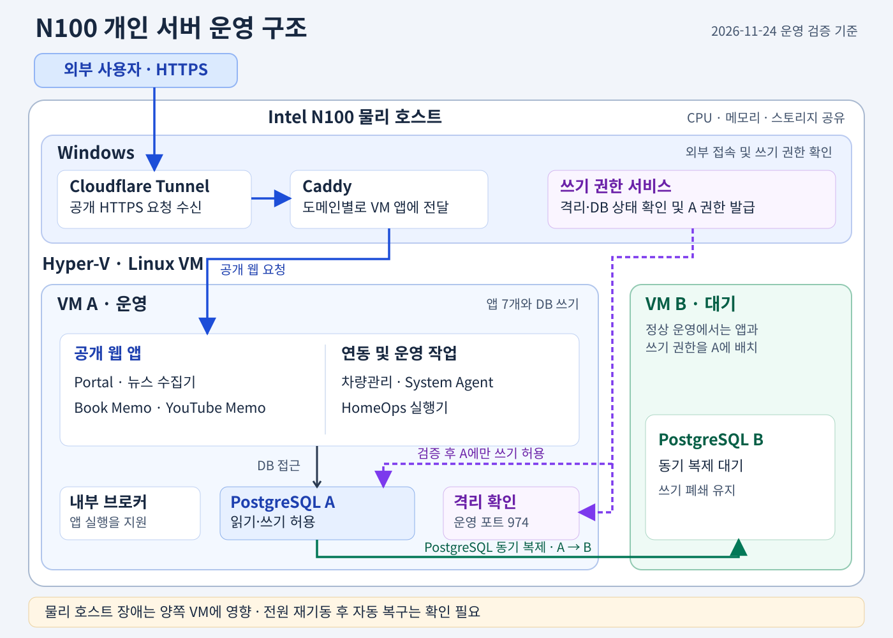
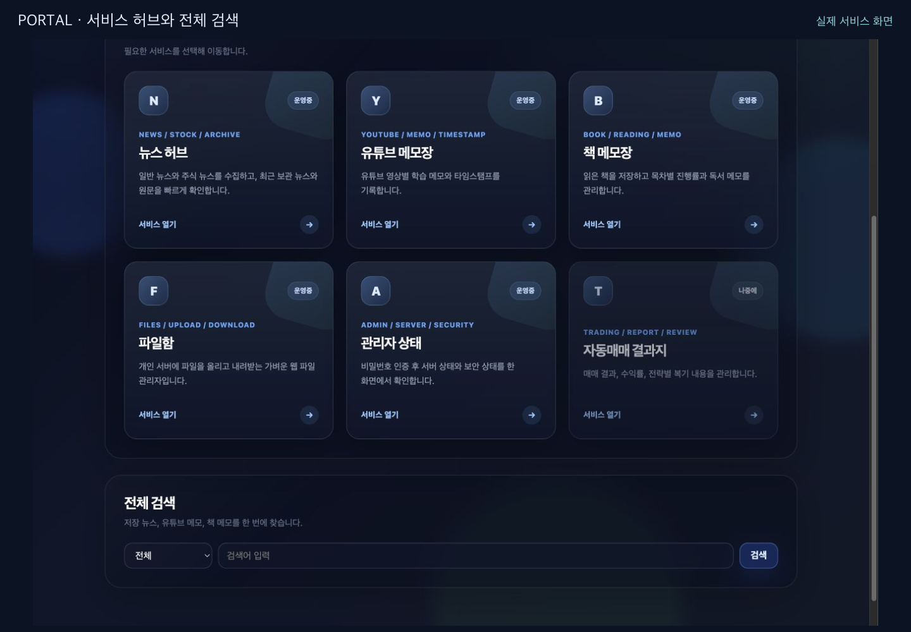
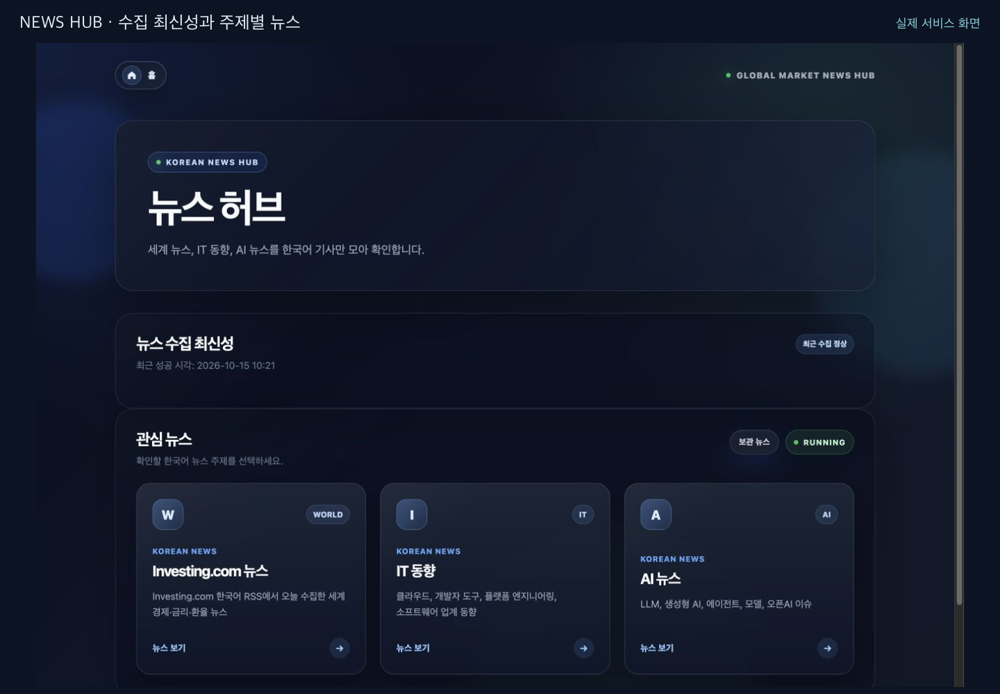
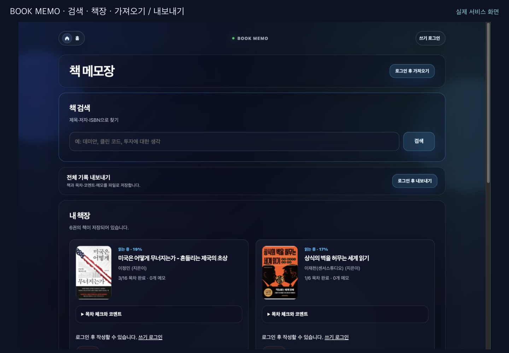
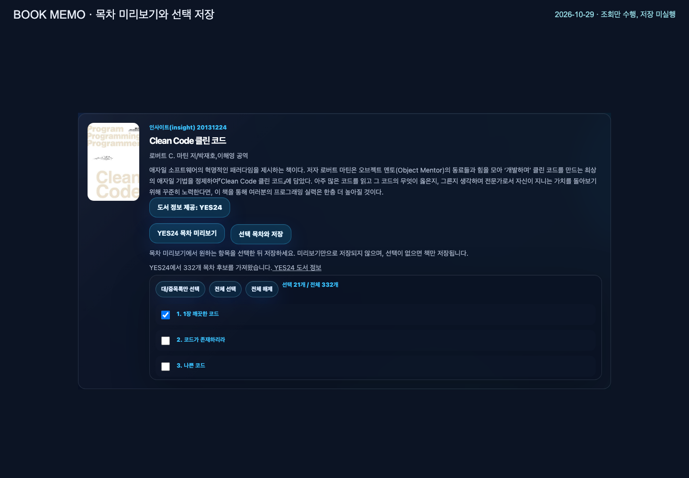
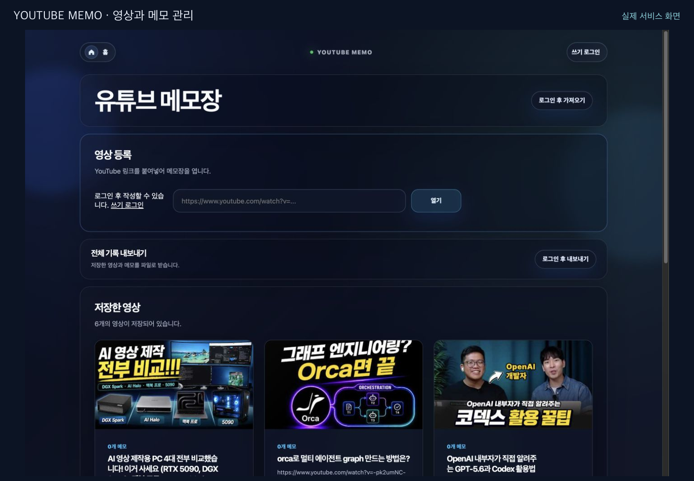
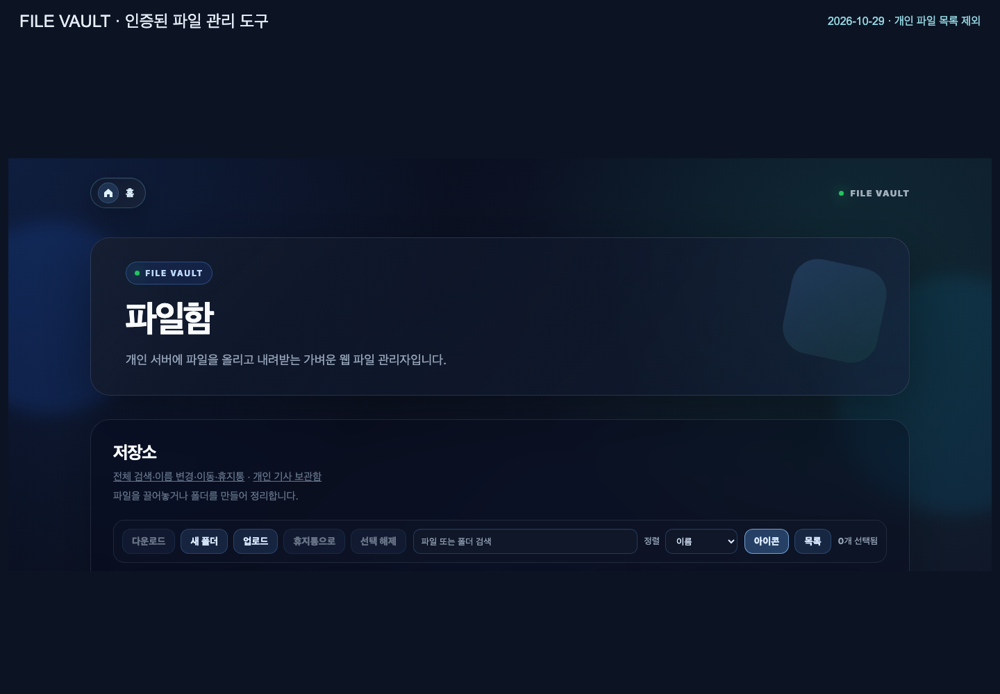
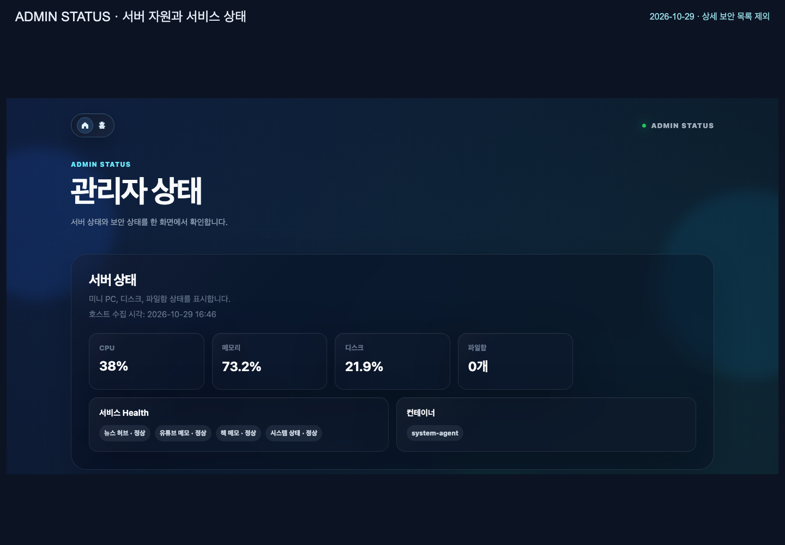
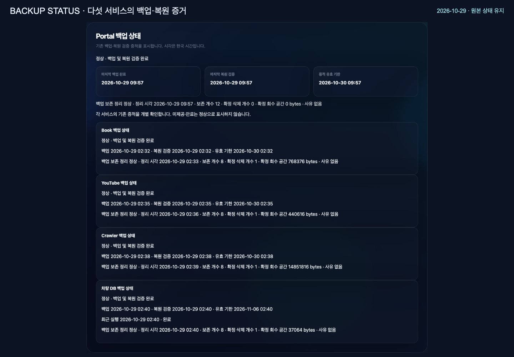
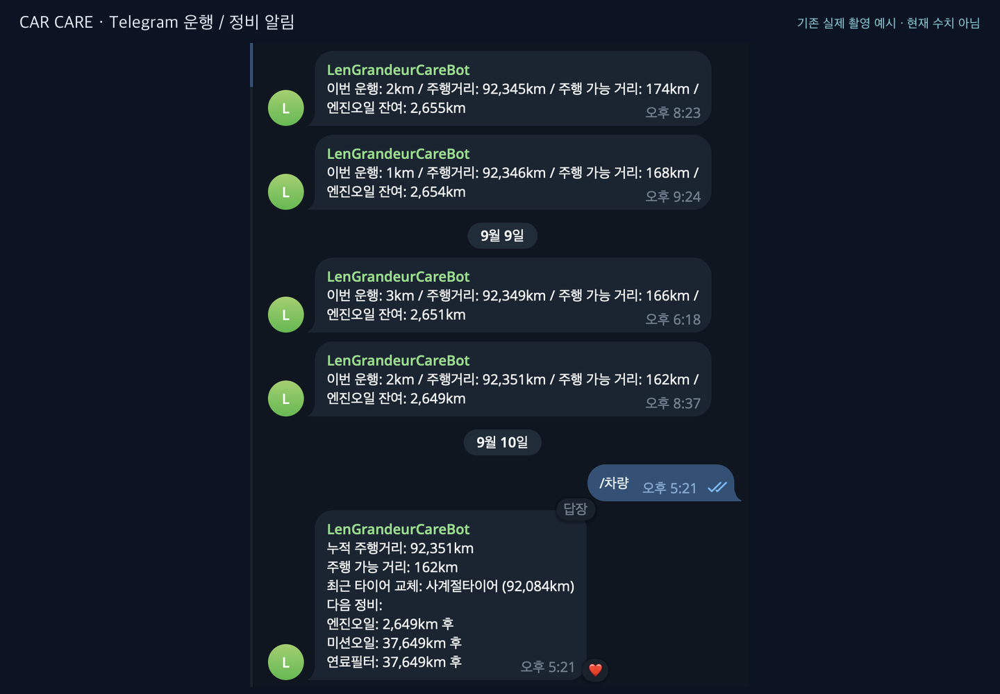

# Personal Server V1

Intel N100 한 대에서 Portal을 포함한 개인 서비스 7개를 운영합니다. Windows가 외부 접속과 쓰기 권한 확인을 담당하고, Hyper-V의 Linux VM 두 대가 PostgreSQL을 동기 복제합니다. 앱은 VM A에서 실행하고 데이터베이스 쓰기도 A에만 허용합니다.

[프로젝트 사례와 면접 문답](docs/portfolio-devops.md) · [포트폴리오 소개 문안](docs/portfolio-content.md) · [VM 운영 기준](docs/n100-vm-operations.md)

## 운영 구조

[](docs/images/n100-vm-architecture.svg)

파란선은 외부 웹 요청, 보라색 점선은 격리 및 쓰기 권한 확인, 초록선은 PostgreSQL 동기 복제 경로입니다. 구조도를 누르면 원본 크기로 볼 수 있습니다.

| 위치 | 담당 |
|---|---|
| Windows | Cloudflare Tunnel과 Caddy로 공개 웹 요청 전달. 격리 상태를 확인하고 DB 쓰기 권한 관리 |
| VM A | Portal, 뉴스 수집기, Book Memo, YouTube Memo, 차량관리, System Agent, HomeOps 실행기와 내부 브로커 실행. PostgreSQL 쓰기 담당 |
| VM B | PostgreSQL 동기 대기. 정상 운영에서 앱과 DB 쓰기 권한은 A에 배치 |
| 물리 호스트 | Windows와 VM 두 대가 같은 N100의 CPU·메모리·스토리지를 공유. N100 전원이나 스토리지 장애는 양쪽 VM에 영향 |

## 가장 어려웠던 점

**N100 한 대의 자원으로 VM 두 대와 서비스 7개의 복구 경로를 함께 운영하는 일이 가장 어려웠습니다.** Windows, 두 VM, PostgreSQL과 앱이 같은 자원을 쓰므로, 평상시 사용량뿐 아니라 장애 복구 중 앱 기동과 DB 검증이 겹치는 순간까지 고려했습니다. 동기 복제와 A 단일 쓰기를 유지하면서, B는 대기 역할로 운영하고 기동 구간을 따로 검증했습니다.

실제 복구 중 Windows 권한 조회가 6초 제한을 넘겨 시작한 앱이 종료된 적이 있었습니다. 같은 Windows 연결에서 갱신이 겹친 읽기만 다시 확인하도록 수정했고, 운영 읽기에서 재확인까지 약 4.4~4.5초를 측정했습니다. 앞선 기동 기록은 보존한 채 중단 지점을 대조한 뒤 앱을 다시 시작했습니다. [설계 판단과 장애 사례](docs/portfolio-devops.md#가장-어려웠던-점)

## 주요 기능

| 서비스 | 사용자 기능 |
|---|---|
| Portal | 전체 검색, 서비스 연결, 파일·메모 관리. 결과가 없을 때와 서비스가 현재 응답 없음 상태일 때를 구분 |
| 뉴스 수집 | 기사 수집·보관과 수집 최신성 확인. 마지막 정상 수집을 표시 |
| Book Memo · YouTube Memo | 책과 영상 메모 검색·저장 |
| 차량관리 | 차량 상태·정비 기록과 연동 작업 |
| System Agent · HomeOps | 시스템 상태 조회와 허용된 운영 작업 |

## 주요 화면

아래는 기존 실제 서비스 캡처입니다. 기능을 보여주는 화면이며, 시각·수치·상태는 촬영 당시 기준입니다. [이미지 출처와 촬영 범위](docs/images/README.md)

### Portal · 서비스 허브와 전체 검색

서비스를 한곳에서 찾아 열 수 있고, 뉴스·책·영상의 검색 대상을 고를 수 있습니다.



<details>
<summary>뉴스 허브 · 수집 상태와 주제별 기사</summary>

마지막 정상 수집 시각을 확인하고, 세계 경제·IT·AI 등 주제별 기사로 이동하거나 기사를 보관할 수 있습니다.



</details>

<details>
<summary>Book Memo · 도서 검색과 목차 선택</summary>

YES24에서 책을 검색하고 책과 메모를 관리합니다. 목차 미리보기에서는 필요한 항목을 골라 저장할 수 있습니다.





</details>

<details>
<summary>YouTube Memo · 영상과 메모 관리</summary>

영상을 등록하고 저장 목록과 메모를 관리합니다. 로그인 후 영상과 메모를 저장하거나 가져오기·내보내기를 사용할 수 있습니다.



</details>

<details>
<summary>파일함 · 업로드, 검색, 이동 및 휴지통</summary>

Portal에서 로그인한 뒤 파일을 업로드·검색·정렬·이동할 수 있습니다. 화면은 개인 파일을 제외한 도구 영역입니다.



</details>

<details>
<summary>관리자 화면 · 서버 상태와 백업 기록</summary>

서버 자원과 서비스 상태를 확인할 수 있습니다. 백업 화면은 확인 가능한 백업·복원 기록을 보여줍니다. 아래 수치와 백업 상태는 이전 촬영 시점의 값입니다.





</details>

<details>
<summary>차량관리 · 운행 및 정비 알림 예시</summary>

차량 운행 기록과 주행거리, 소모품 정비 안내를 제공합니다. 이미지는 과거 Telegram 알림 예시입니다.



</details>

## 검증

2026-11-24 운영 복구에서 앱 7개와 내부 브로커의 기동을 확인했습니다. A·B의 쓰기 폐쇄를 확인한 뒤 A에만 쓰기를 허용했고, B의 동기 대기를 확인했습니다. 기존 DB와 기동 이력을 이어받아, [Portal](https://len.pe.kr/) 첫 화면과 공개 health 응답을 검증했습니다. [운영 검증 범위](docs/n100-vm-operations.md#검증-결과)

**남은 과제는 전원 재기동 후 자동 복구입니다.** VM 자동 시작과 Windows 서비스의 시작 순서를 구성하고, A 단일 쓰기·앱 7개·Portal이 다시 정상화되는지 실제 재부팅에서 확인해야 합니다.

## 빠른 상태 확인

```sh
curl --fail --silent --show-error https://len.pe.kr/health
```

외부 요청 경로의 응답을 확인하는 명령입니다. 두 DB의 역할과 앱 전체 기동 여부는 운영 호스트에서 별도로 확인합니다.

## 운영 문서

- [현재 VM 운영 기준 및 복구 확인 순서](docs/n100-vm-operations.md)
- [운영 문서 색인](docs/README.md)
- [저장소 검증과 변경 절차](docs/codex-work-loop.md)
- [WSL·K3s 전환 전 자동 배포 절차 기록](docs/n100-github-auto-deploy.md)

기능 브랜치에서 변경을 검증하고 PR 검사가 통과하면 main 병합을 진행합니다. 운영 반영과 외부 검증은 별도 기록으로 남깁니다. CI 증적은 90일 보존과 필요한 장기 보관 기준을 따릅니다. [증적 보관 기준](docs/agent-loop-evidence.md)
