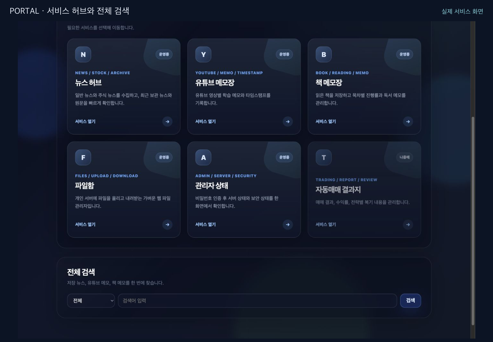
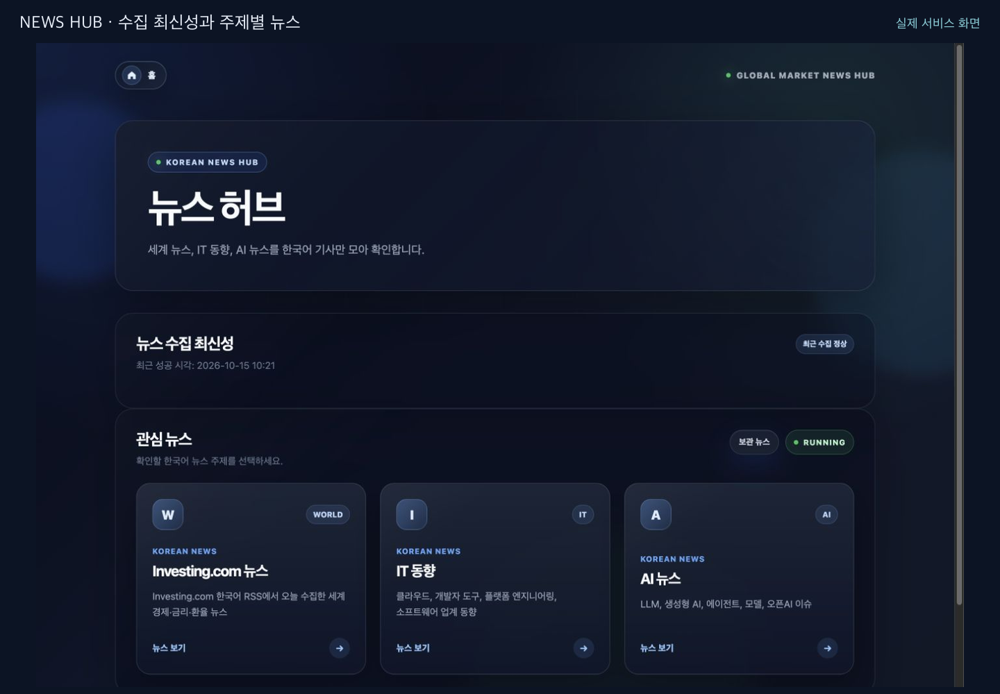
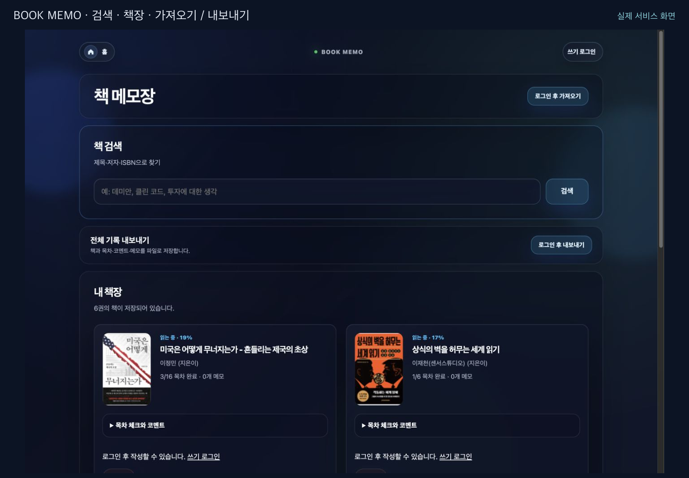
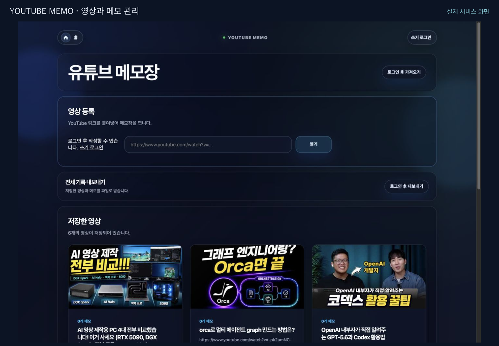
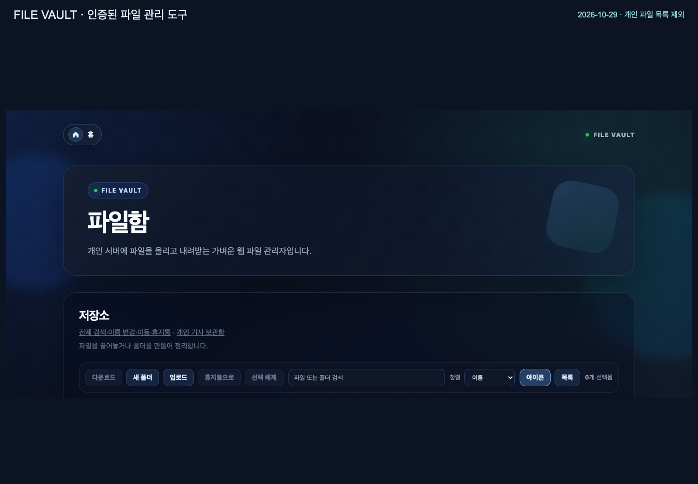
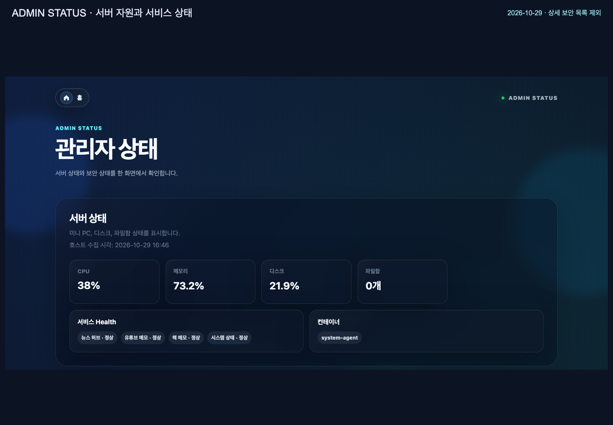
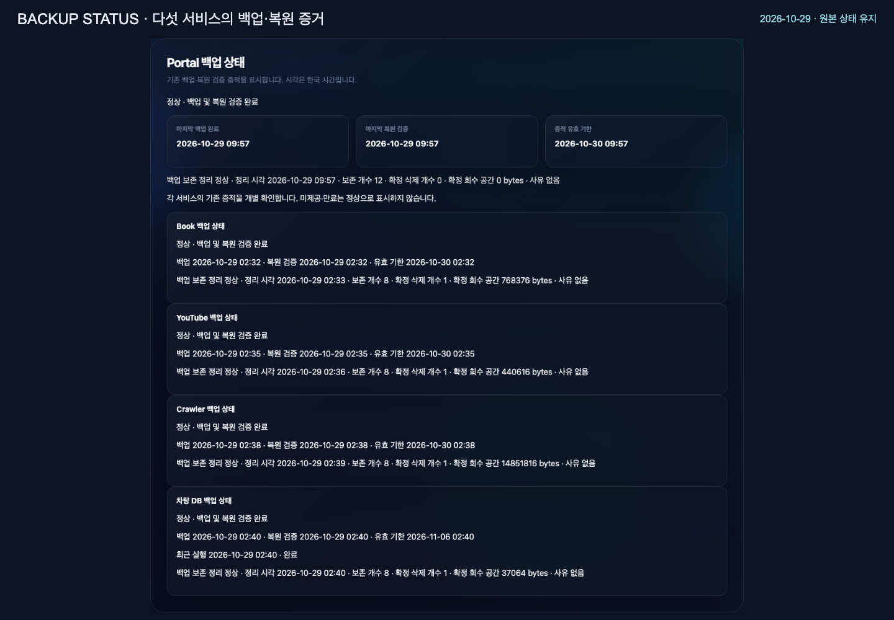
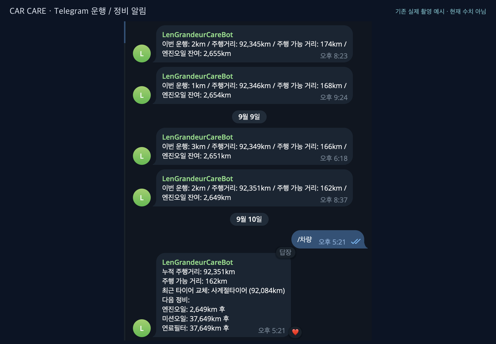
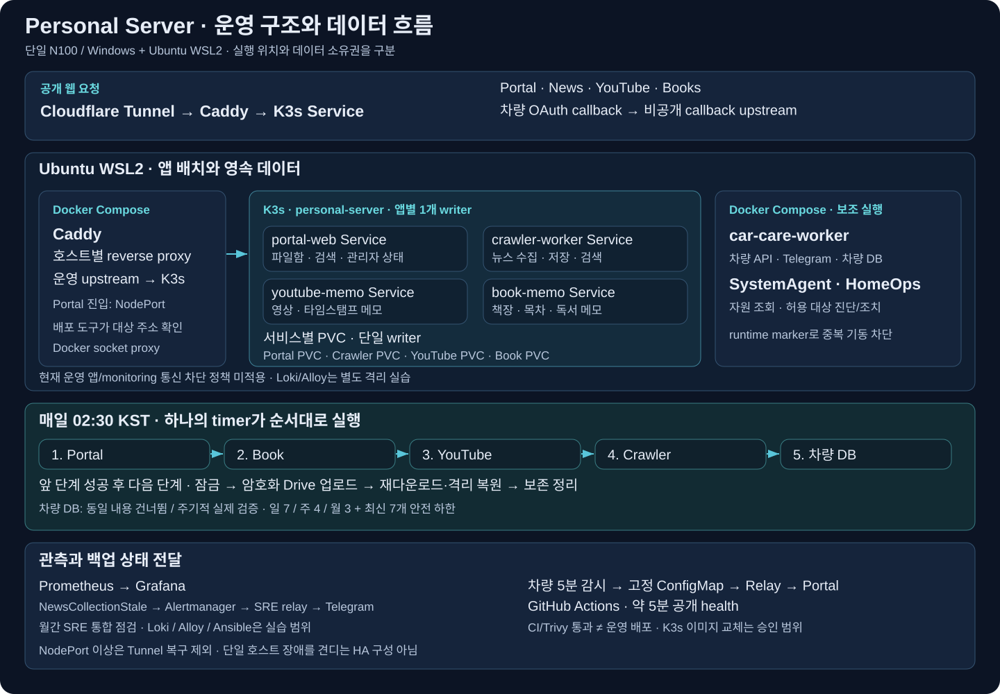
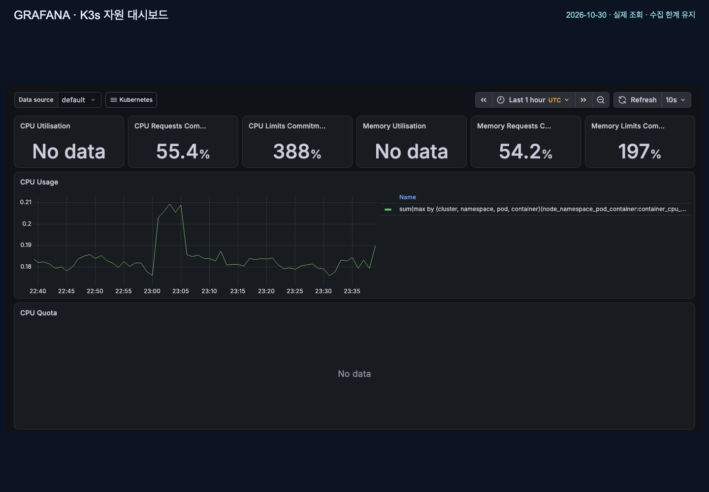

# Personal Server

개인 데이터를 관리하는 서비스를 직접 만들고, 단일 N100 서버에서 배포·장애 감지·백업·복구까지 운영하는 프로젝트입니다. 파일·책·영상·뉴스·차량 정보를 한곳에서 사용할 수 있도록 구성하고, 데이터 보존과 실패 처리에 중점을 뒀습니다.

## 프로젝트 목표와 담당 범위

서비스 구현부터 데이터 저장, 인증, CI/CD, 모니터링과 복구 절차까지 저장소에서 관리합니다. 구현 결과와 함께 **어떤 문제가 있었고, 왜 이 구조를 선택했으며, 무엇으로 검증했는지** 정리했습니다.

| 영역 | 구현·운영 범위 |
|---|---|
| 애플리케이션 | FastAPI API, 서버 렌더링 화면, 서비스 통합 검색, 파일·메모·기사·차량 데이터 관리 |
| 데이터 보호 | SQLite 트랜잭션, 요청 중복 방지, 편집 충돌 검사, 파일 배타적 생성, 단일 writer |
| 운영 | K3s·Compose 실행 위치 구분, 이미지 배포·원복, 상태 검사, 제한형 복구 |
| 관측과 복구 | 내부 지표·외부 health, 장애 알림, 암호화 백업·격리 복원, 보관 정리·누락 감지 |
| 검증 | 서비스별 회귀 테스트, 브라우저 검사, 운영 도구 계약 검사, CI·보안 검사 |

## 주요 기능

| 서비스 | 기능 |
|---|---|
| Portal | 뉴스·책·영상 전체 검색, 서비스별 실패 표시와 재시도, 관리자 상태·백업 증적, 포트폴리오 |
| 파일함 | 다중 업로드, 폴더·파일 검색/이동/이름 변경, ZIP 다운로드, 휴지통·충돌 방지 복원, 개인 기사 보관 |
| News Hub | RSS 뉴스 수집·검색·보관, Telegram 알림 분류, 수집 최신성 확인 |
| YouTube Memo | 영상 등록, 타임스탬프 메모, 편집·태그·페이지 이동, JSON/Markdown 내보내기·선택 내보내기·JSON 가져오기·휴지통 |
| Book Memo | 책 검색·책장, 목차 체크·코멘트·메모, 편집·페이지 이동, JSON/Markdown 내보내기·선택 내보내기·JSON 가져오기·휴지통 |
| 차량관리 | Hyundai 연동, 운행 기록·주행거리·정비 주기 관리, Telegram 명령과 운행 종료 알림 |
| HomeOps | 허용된 대상의 진단·승인형 조치, 재시작 요청 중복 방지, 실행 이력 |

## 주요 화면

서비스별 이미지를 **1440 × 1000** 프레임으로 통일하고, 기능과 입력 도구를 읽을 수 있도록 한 장씩 표시했습니다. 공개 웹 4개와 인증 화면 2개는 현재 서비스에서 다시 촬영했습니다. Grafana·Telegram은 기존 실제 촬영 예시로 구분합니다. 화면에 보이는 수치는 촬영 당시 값이며 실시간 상태를 의미하지 않습니다. [이미지별 범위와 검증 기준](docs/images/README.md)

### Portal · 서비스 허브와 전체 검색

서비스 이동과 뉴스·유튜브·책 검색 대상을 한곳에서 선택합니다.



### News Hub · 수집 최신성과 주제별 뉴스

마지막 정상 수집 시각과 상태를 확인하고 세계 경제·IT·AI 뉴스로 이동합니다.



### Book Memo · 책장과 기록 관리

책 검색·진행률·목차 진입점과 로그인 후 가져오기·내보내기 위치를 확인합니다. 긴 목차는 화면에서 접어 책장이 보이도록 촬영했습니다.



### YouTube Memo · 영상과 메모 관리

영상 등록·저장 목록과 가져오기·내보내기 위치를 확인합니다. 쓰기는 로그인 뒤 사용할 수 있습니다.



### 파일함 · 파일 작업 도구

업로드·검색·정렬·이동·휴지통과 개인 기사 보관 진입점을 제공합니다. 인증된 실제 화면의 도구 구간을 사용하며 개인 파일 내용은 포함하지 않습니다.



### 관리자 상태 · 서버와 백업

서버 상태와 서비스별 백업·복원 증거를 확인합니다. 내부 주소와 보안 이벤트의 상세 목록은 제외합니다.





### 차량관리 · Telegram 알림 예시

운행 기록·주행거리·소모품 정비 안내를 Telegram으로 제공합니다. 아래 이미지는 기존 실제 메시지 예시이며 현재 차량 상태나 신규 백업 성공을 나타내지 않습니다.



## 구조와 기술 선택



외부 웹 요청은 Cloudflare Tunnel → Compose의 Caddy → K3s Service로 전달됩니다. Portal은 NodePort로 진입하고, 뉴스·책·영상은 각각의 K3s Service가 처리합니다. 차량 OAuth callback은 Caddy를 거치지 않는 별도 Tunnel 경로입니다. 구성도는 실제 실행 중인 서비스·저장소·timer와 코드에 정의된 데이터 흐름을 대조해 작성했습니다.

K3s의 웹 앱 4개와 Compose의 차량관리·SystemAgent·HomeOps는 역할을 나눠 운영합니다. 백업은 단일 timer가 Portal → Book → YouTube → Crawler → 차량 DB 순으로 실행하며, 차량 백업 감시 결과는 고정 ConfigMap → Relay → Portal 관리자 화면으로 전달됩니다. 개별 실행의 성공 여부는 구성도와 별도로 실제 복원 증거를 확인합니다.

| 영역 | 기술 | 선택 이유 |
|---|---|---|
| 웹·API | Python, FastAPI, Jinja2, JavaScript | 서비스별 요청 처리와 서버 렌더링을 구성하고 필요한 화면 동작만 브라우저에서 처리 |
| 저장 | SQLite, JSON, 파일 시스템 | 개인 데이터 규모에서 별도 DB 서버 부담을 줄이고 서비스별 데이터를 분리 |
| 실행 | Windows N100, Ubuntu WSL2, K3s, Docker Compose | 웹 앱 4개는 Deployment·readiness·PVC로 관리하고 차량 연동·호스트 상태·허용 조치는 Compose에 분리 |
| 외부 접근 | Cloudflare Tunnel, Caddy | 공개 호스트별 요청과 내부 서비스 실행 위치를 연결 |
| 관측·알림 | Prometheus, Grafana, Alertmanager, SRE Relay, Telegram | 내부 지표·수집 중단·백업 누락과 외부 health를 구분해 감시하고 알림 전달 |
| 백업·복구 | systemd user timer, Kubernetes Job, 암호화 Google Drive | 단일 잠금과 순차 실행으로 부하·중복 writer를 제한하고 원격 사본의 격리 복원 뒤 보존 정리 |
| 상태 연결 | SystemAgent, HomeOps, 고정 ConfigMap·Relay 내부 API | Portal에서 운영 지표·허용 조치·차량 백업 상태를 조회하되 자격 증명이나 차량 원문은 노출하지 않음 |
| 배포·보안 | GitHub Actions, unittest, Trivy | 변경 영향에 따른 검사, 이미지 보안 검사, 배포 대상 제한 |

### 서비스와 저장소를 나눈 이유

뉴스 수집, 메모, 파일 관리는 실행 주기와 데이터 형태가 다릅니다. 각 서비스가 자신의 데이터를 관리하고 Portal은 검색 API로 결과를 모읍니다. 한 서비스의 실패가 나머지 결과를 가리지 않도록 처리합니다.

SQLite와 파일 저장을 사용하므로 동시 쓰기와 배포 중 데이터 접근을 직접 관리해야 합니다. K3s 앱은 PVC에 데이터를 보관하고 같은 운영 데이터를 수정하는 실행 주체는 하나만 유지합니다.

### K3s와 Compose를 함께 쓰는 이유

Portal·Book·YouTube·Crawler는 K3s의 Deployment·Service·readiness·PVC를 기준으로 운영합니다. 차량관리·SystemAgent·HomeOps 실행기는 Compose에서 실행합니다. 배포와 복구 도구가 실제 실행 위치를 확인해 K3s 소유 서비스를 Docker에서 중복 실행하지 않도록 구성했습니다.

#### Crawler Worker K3s 현재 운영 기준

뉴스 수집과 저장은 K3s `crawler-worker`가 담당합니다. 기존 Docker 컨테이너는 중지된 원복 자산이며 동시에 실행하지 않습니다. [실행 주체·복구 기준](docs/operations-reference.md#뉴스-수집-k3s-현재-운영-기준)을 따릅니다.

## 개발하면서 해결한 문제

### 1. 검색 결과 없음과 서비스 실패 구분

빈 목록만 반환하면 검색어와 일치하는 자료가 없는지, 대상 서비스가 실패했는지 알 수 없습니다. 서비스별 결과와 상태를 분리하고 실패에는 `현재 응답 없음`을 표시했습니다. 세 서비스를 병렬 조회하고 조회 대기 예산을 1.5초로 제한했습니다. 이 값은 전체 브라우저 응답 시간 보장이 아닙니다.

근거: [통합 검색](portal-web/app/services/global_search.py), [회귀 테스트](tests/test_portal_dashboard.py)

### 2. 동시 업로드와 정리 과정의 파일 덮어쓰기 방지

존재 여부 확인과 파일 생성 사이에 다른 요청이 들어오는 경쟁 조건을 배타적 생성 모드(`xb`)로 처리했습니다. 파일을 생성한 요청만 쓰기를 진행하며, 생성에 실패한 요청이 다른 요청의 파일을 지우지 않도록 했습니다.

근거: [파일 저장](portal-web/app/services/file_store.py), [접근·동시성 테스트](tests/test_file_access.py)

### 3. 응답 유실·재처리·동시 편집에서 데이터 보호

메모 쓰기는 요청 ID·본문 해시·결과를 업무 데이터와 같은 SQLite 트랜잭션에 저장합니다. 응답이 유실된 재시도는 기존 결과를 사용하고, 오래된 버전의 편집은 409로 거부합니다. DB 쓰기 잠금은 503과 재시도 안내로 반환하며 화면의 입력·버전·요청 ID를 유지합니다.

차량 Telegram 명령도 메시지 식별자와 처리 결과를 영속 저장해 정비 이력 중복을 방지합니다. 로그인 이동 전에는 같은 탭의 초안을 보관하고 저장 공간을 사용할 수 없으면 내용을 복사하도록 안내합니다.

근거: [차량 저장](car-care-worker/app/services/store.py), [Telegram 처리](car-care-worker/app/services/telegram.py), [Book 테스트](tests/book_memo/test_memo_recovery.py), [YouTube 테스트](tests/youtube_memo/test_memo_recovery.py)

### 4. 화면이 열려도 수집기가 멈춘 상태 감지

보관된 기사가 계속 표시되면 수집 장애가 숨겨질 수 있습니다. `마지막 정상 수집`, 마지막 시도와 연속 실패를 따로 기록해 수집 최신성을 판단합니다. 상태 API에는 기사 내용이나 자격 증명을 포함하지 않습니다.

근거: [수집 상태](crawler-worker/app/services/news_collection_status.py), [관측 기준](docs/operations-reference.md#뉴스-수집-관측성)

### 5. 배포·복구 중 중복 writer 방지

배포와 복구 전에 runtime marker와 실제 서비스 상태를 대조합니다. 표시가 누락·중복되거나 신뢰할 수 없으면 작업을 중단하고 K3s 소유 서비스는 Docker 동작에서 제외합니다. N100 제한형 자동복구와 HomeOps는 허용 대상·조건·실행 간격·횟수 제한을 사용합니다.

근거: [실행 위치 검사](scripts/runtime-service-state-reader.py), [HomeOps 동작](homeops-executor/app/services/docker_ops.py), [실행 위치 계약](tests/test_runtime_service_state.py)

### 6. 백업 파일 존재와 실제 복구 가능성 구분

백업은 암호화 업로드 후 같은 원격 파일을 다시 내려받아 무결성·SQLite 또는 파일 구조·격리 복원을 확인합니다. 관리자 상태는 원본 복원 시각과 유효 기간을 사용하며 상태 조회만으로 증거를 새 성공으로 갱신하지 않습니다.

복원 검증 뒤 일·주·월 복구 지점과 최신 7개 안전 하한을 적용해 오래된 사본을 정리합니다. 삭제 전 계획·현재 inventory·암호문 digest·최신 복원 증거를 대조하고 결과가 불명확하면 중단합니다. 특정 보관 정리 작업에서 2.34→0.98GiB,58.1% 감소를 실측했으며 일반적인 절감률 보장은 아닙니다.

근거: [보관 정책](infra/k8s/tools/pvc_backup_retention.py), [순차 실행](infra/k8s/tools/pvc-backup-sequence.py), [차량 자동화](car-care-worker/tools/automation/README.md)

## 운영과 데이터 보호

| 항목 | 현재 운영 방식 |
|---|---|
| 백업 순서 | 매일 02:30 KST Portal→Book→YouTube→Crawler→차량 DB. 기존 네 단계가 모두 성공한 뒤 차량 호출 |
| 변경 감지 | 차량 DB 내용이 같으면 업로드·원격 정리 생략. 일요일에는 실제 백업·복원 검증 |
| 차량 보관 | 일간 7·주간 4·월간 3 및 최신 7개 안전 하한. 성공 실행 기록은 30일 후 정리하되 최신·실패·불확실 기록과 증적 보존 |
| 백업 누락 | 서버가 5분마다 완료 기록 확인,09:00 이후 당일 미완료 통보. 공유잠금 점유 시 유예 |
| 관측 | Prometheus·Grafana·관리자 상태와 약 5분 간격 외부 health 감시 |
| 인증 | 관리자·파일함·메모 쓰기 권한 분리, Origin 검사, HttpOnly·SameSite 쿠키와 영속 인증 실패 제한 |
| 이미지·데이터 | 이미지 교체와 데이터 변경 분리, non-root·고정 digest·Action SHA·Trivy 검사 |
| 복구 | 현재 이미지와 원복 자산·데이터를 보존하고 정확한 대상에만 제한 조치 |

### 모니터링 화면

아래는 N100에서 촬영한 기존 Grafana 화면 예시입니다. 현재 수치의 증거로 사용하지 않습니다. WSL2 환경에 맞춰 node-exporter를 비활성화한 구성이라 상단의 일부 CPU·메모리 사용률 패널은 `No data`로 표시됩니다. 조회 가능한 그래프와 누락된 지표를 구분해 사용하고 있습니다.



## 검증

정상 요청뿐 아니라 인증 실패, 잘못된 입력, 동시 저장, 부분 장애와 재시작 후 재처리를 회귀 테스트로 확인합니다. 서비스별 Python·의존성을 분리하고 로컬 실행기와 CI가 같은 테스트 목록을 사용합니다. 운영 도구는 계약 검사, 실제 서비스 교체는 준비 상태·외부 응답·기존 데이터 보존으로 구분해 검증합니다.

```bash
python3 tests/run_service_tests.py
python3 -m unittest tests.test_documentation_index tests.test_documentation_links
```

[면접 설명 자료](docs/portfolio-devops.md)에 설계 판단·검증 근거·예상 질문을 정리했습니다. Loki·Ansible은 격리 실습 범위에서 샘플 로그 조회, 실제 재실행 변경 0건과 원복을 확인했습니다.

### 배포 흐름

기능 브랜치→관련 테스트·검토→PR·필수 CI→main 병합→배포 분류→승인된 운영 교체→데이터·상태 검증 순으로 진행합니다. Compose 안전 배포는 허용된 서비스만 대상으로 하며 K3s 소유 앱은 별도 이미지 교체 절차를 사용합니다. 코드 검사 성공을 운영 배포 성공으로 대신하지 않습니다.

CI 산출물과 운영 증적은 90일 보관하며, 장기 보관이 필요한 자료는 별도 증적 저장소로 이전합니다.

## 현재 한계와 검증 범위

단일 N100과 WSL2 구성이라 호스트 장애를 견디는 다중 노드 고가용성은 제공하지 않습니다. SQLite·파일 기반 단일 writer를 전제로 하며 다중 쓰기 인스턴스 확장에는 저장 구조 변경이 필요합니다. Grafana 일부 호스트 지표는 수집되지 않으며 운영 통신 차단 정책은 미적용 상태입니다.

메모 재시도 보호는 지정된 쓰기 경로에 적용됩니다. 탭 종료 후 초안 복구나 모든 중간 데이터 변경의 복원은 보장하지 않습니다. SLI·에러 버짓·RTO/RPO의 종합 실측과 인증의 장기 유지·Telegram 단말 수신은 추가 확인이 필요합니다. 차량을 포함한 정기 실행과 기간 만료 사본의 실제 자동 삭제는 이미지나 CI 대신 각 실행 기록·복원 증거·삭제 결과를 대조해 판단합니다.

## 빠른 상태 확인

구성이 완료된 N100의 WSL에서 사용하는 읽기 점검입니다.

```bash
cd /mnt/c/personal-server
curl --fail --silent --show-error https://len.pe.kr/health
sudo k3s kubectl -n personal-server get deploy,pod,pvc
bash infra/k8s/tools/sre-health-audit.sh
```

## 운영 문서

| 문서 | 내용 |
|---|---|
| [문서 색인](docs/README.md) | 현재 기능·운영·검증 안내 |
| [면접 설명 자료](docs/portfolio-devops.md) | 설계 판단, 문제 해결과 예상 질문 |
| [운영 참조](docs/operations-reference.md) | 서비스 구조와 백업·감시·복구 기준 |
| [N100 운영 환경](docs/n100-mt4-setup.md) | Windows·WSL2 시작과 장애 대응 |
| [안전 자동 배포](docs/n100-github-auto-deploy.md) | 배포 대상 제한과 검증·원복 절차 |
| [K3s 운영](infra/k8s/README.md) | 앱·모니터링·백업 운영 도구 |
