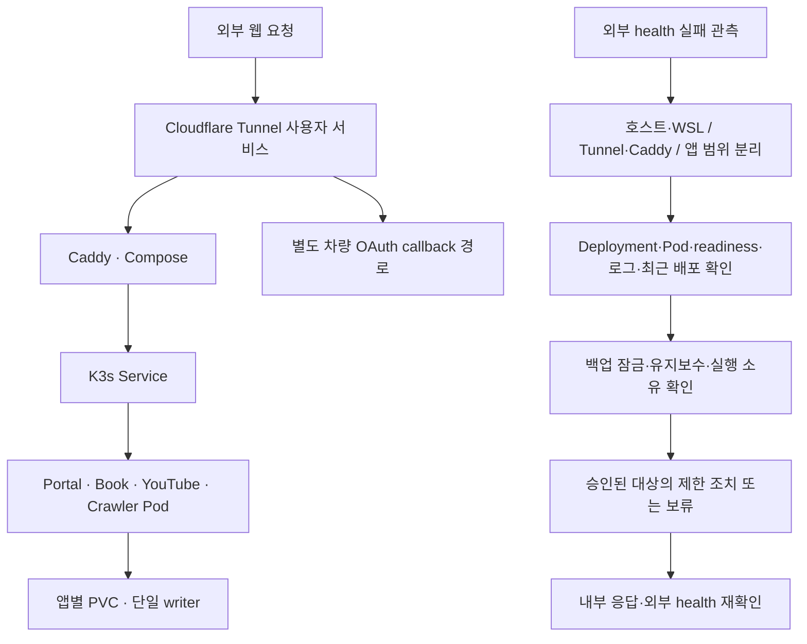

# V1 정상 상태 점검표와 요청·복구 흐름

## 1. 문서 정보

| 항목 | 내용 | 비고 |
|---|---|---|
| 기준일 | 2026-10-26 | Asia/Seoul |
| 수행 주체 | Codex 에이전트 | 사용자 직접 설명·실습 완료는 확인 필요 |
| 관측 근거 | Portal 배포 완료17:24, 별도 외부 관측23:02~23:03 및 사후 실행 상태 조회 | 지속 관측·동일 시각의 전체 시스템 스냅샷으로 확대하지 않음 |
| 적용 소스 | `7b420271e2490b1b2e9ba02fb22eaeceb793551b` | 이후 기록 전용 커밋은 N100에 추가 동기화하지 않음 |
| 기준 자료 | [운영 참조](operations-reference.md), [README](../README.md), [배포 원본 대조 결과](reviews/20261026_Portal업로드안전성_운영적용결과.md) | 코드·현재 관측·미확인을 구분함 |

## 2. 핵심 요약

공개 웹 요청은 Tunnel→Compose Caddy→K3s Service→앱 Pod로 전달됨. 웹 앱4종은 K3s, 차량·호스트 상태·제한형 조치는 Compose가 소유함. 실행 이미지와 데이터 PVC를 분리하며 앱 writer를 Docker에 중복 생성하지 않음. 차량 OAuth callback은 별도 Tunnel 경로임.

## 3. 상세 내용

### 3.1. 정상 상태 기준

| 대상 | 실행 주체·진입 경로 | 데이터 위치·경계 | 현재 근거·결과 | 비고 |
|---|---|---|---|---|
| Portal | K3s Deployment/Service, 공개 호스트→Tunnel→Caddy→NodePort/Service→Pod | files·state 두 PVC | 실제 단일 Ready Pod, UID10001·새 imageID·원본4파일·health/ready/admin200 | Recreate·replica1 |
| Book | K3s Deployment/Service, books 호스트 경로 | book-memo-data PVC | desired/Ready1, Recreate, 연계 health 정상 | 현재 PVC 참조 조회 |
| YouTube | K3s Deployment/Service, memo 호스트 경로 | youtube-memo-data PVC | desired/Ready1, Recreate, 연계 health 정상 | 현재 PVC 참조 조회 |
| Crawler | K3s Deployment/Service, news 호스트 경로 | crawler-worker-data PVC | desired/Ready1, Recreate, 연계 health 정상 | Compose 중복 writer 없음 확인 |
| Caddy·차량·SystemAgent·HomeOps·socket proxy | Compose | 앱별 설정·차량 데이터 및 제한 권한 경계 | 배포 전후 ID/image/시작 시각/restart 동일 | 웹 앱4종은 Compose 실행 대상 아님 |
| Tunnel | WSL 사용자 서비스 | 자격 증명 값은 수집·기록하지 않음 | active/running, PID·시작 시각 동일 | ingress 변경 없음 |
| 백업 | 공유잠금·기존 순차 실행 | 운영 데이터와 격리 복원 결과를 구분함 | 작업 전후 활성Job0, 종료 후 잠금 free | 미래 정기 실행 성공 확인 아님 |

Portal PVC는 `portal-web-files-dynamic`, `portal-web-state-dynamic`임. Pod 교체는 실행 주체의 교체이며 PVC 데이터의 삭제·원복을 의미하지 않음. 이미지 원복과 데이터 복원은 별도 절차임.

### 3.2. 요청·복구 흐름도

### 3.3. 실패를 구분하는 읽기 순서

| 관측 | 먼저 확인할 근거 | 판단 기준·완료 조건 | 비고 |
|---|---|---|---|
| 특정 앱만 실패 | Deployment desired/Ready, Pod 상태·imageID·readiness·로그·최근 배포 | 이미지 부족·기동 실패·준비 상태 실패·기능 실패를 구분함 | 정상 K3s 전체 재시작으로 확대하지 않음 |
| 앱 내부는 정상, 외부 실패 | Tunnel·Caddy·Service/Endpoint와 공개 host 경로 | 실패가 생긴 구간을 좁히고 내부·외부 응답을 각각 설명함 | Portal 로그만으로 Tunnel 상태를 단정하지 않음 |
| 여러 앱 동시 실패 | N100/WSL/K3s, 공통 진입 경로·유지보수·백업 | 공통 원인과 앱 단독 실패를 구분함 | 읽기 점검을 실제 재시작 승인으로 확대하지 않음 |
| 자동복구 실패 반복 | bootstrap의 감지/복구/보류 조건·실행 소유·실패 횟수 | 승인된 대상만 조치하고 같은 구성요소3회 연속 실패 시 중단함 | 정책 코드와 실제 장애 재현을 구분함 |
| 복구 후 | imageID·단일 writer·Ready·내부 응답·외부 health3회 | 조치 전후 근거와 미확인 항목을 남김 | 단일 N100 호스트 장애·고가용성 한계 유지 |

## 4. 검토 결과

원격 자원과 코드/운영 문서의 실행 소유·진입 경로·데이터 경계를 대조함. 이번 정상 기준은 실제 배포 및 읽기 관측을 근거로 작성했으며 장애를 새로 주입하거나 자동복구·백업을 다시 구현하지 않음. 전문 검토·문서 CI·저장소 반영의 최종 근거는 해당 기록 PR에 남김.

## 5. 확인 필요 사항

사용자 직접 요청 추적·흐름 설명·장애 진단 실습, 실제 운영 데이터 byte 비교, 장애 발생 시 복구 성공, 지속 가용성과 향후 백업 결과는 확인 필요함. 현재 문서의 관측을 해당 성공으로 확대하지 않음.

## 6. 후속 조치

[주차별 계획](20261026_V1_고도화학습계획.md)의 사용자 직접 학습은 미완료 상태를 유지함. 직접 학습의 첫 행동은 V2 정상 상태·요청 추적 후 README·운영 참조와 이 흐름도를 대조하여 각 서비스의 실행 주체·진입 경로·데이터 위치를 설명하는 것임. 실제 설명·수행 결과가 확인된 뒤에만 학습 상태를 갱신함.
