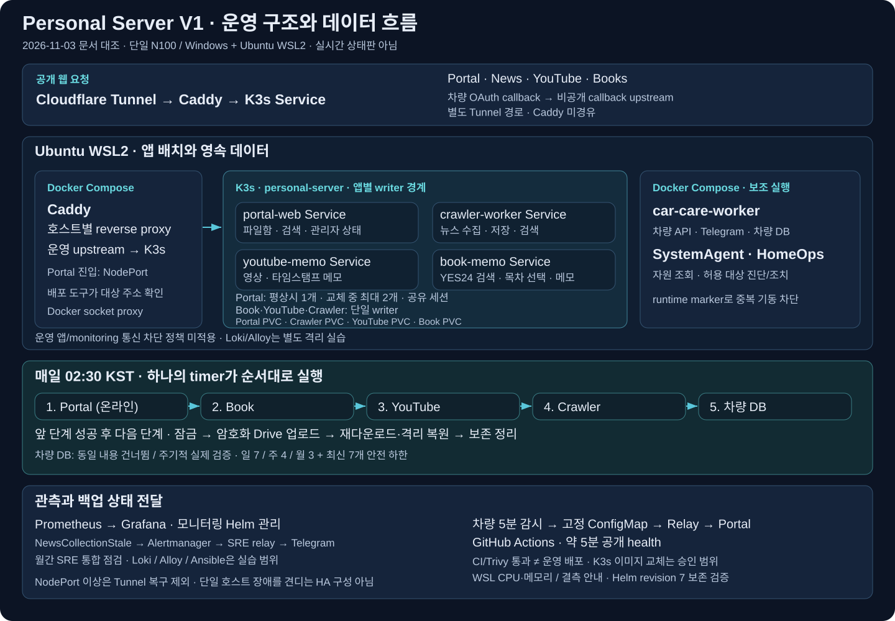

# V1 쉽게 이해하기 — 개념·실제 흐름·면접 질문 24개

## 1. 이 문서를 읽는 방법

| 항목 | 내용 | 비고 |
|---|---|---|
| 작성일 | 2026-11-03 | 학습 설명체로 작성 |
| 기준 | V1 `ab12615`의 코드·문서·검증 기록 | [공통 기준자료](20261103_V1V2_학습기준자료.md)에 고정 원본 연결 |
| 대상 | 이미 만들어진 V1의 동작을 이해하고 면접에서 설명하려는 학습자 | 본인 직접 구현·운영 범위는 별도 확인 |
| 구성 | 12개 주제, 주제마다 예상 질문 2개 | 총 24개, 답변은 연습 예시 |

각 장은 **쉬운 뜻 → 필요한 이유 → V1의 실제 연결 → 면접 답변** 순서입니다. 먼저 이해한 뒤 답변을 본인 말로 바꿔 보세요. 이 자료는 운영 명령 실행 안내가 아닙니다.

## 2. 주제 1 — V1은 무엇을 운영하는가?

### 쉬운 설명

V1은 파일·책·영상·뉴스·차량 정보를 관리하는 여러 앱과, 그 앱을 유지하는 운영 도구를 함께 만든 프로젝트입니다. 화면을 만드는 것에서 끝나지 않고 저장·배포·관측·백업·복구를 연결합니다.

Portal은 여러 서비스를 찾아가는 입구이자 통합 검색 창구입니다. Book·YouTube·Crawler는 자기 기능과 데이터를 관리합니다. Portal이 검색을 요청하더라도 모든 데이터를 Portal DB에 합쳐 보관하는 구조는 아닙니다.



**기억할 흐름:** 사용자 요청 → 앱 처리 → 데이터 저장 → 상태 관측 → 실패 대응.

### Q1. 어떤 프로젝트인가요?

> 개인 데이터를 관리하는 여러 서비스를 N100 한 대에서 운영하는 프로젝트입니다. 웹 기능뿐 아니라 저장 중복·동시 편집·배포·백업 복구의 안전성을 함께 다뤘습니다. 단일 호스트라는 한계도 구분해 설명하고 있습니다.

꼬리질문 대비: 담당한 요구·판단·직접 실행과 에이전트 지원 결과를 구체적으로 구분하세요.

### Q2. 왜 서비스를 나눴나요?

> 책 메모, 영상 메모, 주기적인 뉴스 수집은 기능과 실행 주기가 다릅니다. 각 서비스가 자기 데이터를 관리하도록 나누고 Portal은 API로 결과를 모았습니다. 한 대상이 실패하더라도 나머지 결과는 보여주도록 했습니다.

꼬리질문 대비: 서비스 분리는 장애를 완전히 격리하지는 않습니다. 같은 N100·디스크·네트워크를 공유합니다.

근거: [README](../README.md), [통합 검색](../portal-web/app/services/global_search.py).

## 3. 주제 2 — 서버·WSL·이미지·컨테이너·Compose·K3s

### 쉬운 설명

N100은 실제 장비인 **물리 호스트**입니다. Windows 위에서 WSL2로 Ubuntu Linux 환경을 사용합니다. 앱은 컨테이너로 실행합니다.

이미지는 앱을 실행하는 데 필요한 코드·라이브러리·기본 환경을 묶은 배포물이고, 컨테이너는 그 이미지를 바탕으로 실행한 프로세스 환경입니다. Dockerfile은 이미지를 만드는 조리법에 해당하지만, 이미지가 실행 중인 서버 그 자체는 아닙니다.

Compose는 여러 컨테이너의 실행 설정을 묶어 관리합니다. K3s는 Kubernetes를 가볍게 구성한 배포판으로, 웹 앱의 배치·준비 상태·교체·저장소 연결을 관리합니다. V1은 웹 앱 4개를 K3s에서, 차량관리·SystemAgent·HomeOps 같은 보조 작업을 Compose에서 운영합니다.

### Q3. 이미지와 컨테이너는 어떻게 다른가요?

> 이미지는 실행할 앱과 환경을 묶은 배포물이고, 컨테이너는 그 이미지로 실행한 인스턴스입니다. 같은 이미지에서도 설정과 연결된 데이터가 다르면 동작이 달라질 수 있습니다. 컨테이너를 교체해도 데이터가 남도록 저장소 수명을 분리했습니다.

꼬리질문 대비: “같은 이미지”만으로 Secret·설정·DB 상태까지 동일하다고 보장할 수 없습니다.

### Q4. 왜 Compose와 Kubernetes를 같이 쓰나요?

> 웹 앱은 Deployment·readiness·PVC로 관리하고, 호스트와 가까운 보조 작업은 Compose로 나눴습니다. 두 관리 경로가 있으므로 배포와 복구 전에 실행 주체를 확인하고 같은 데이터를 쓰는 앱의 중복 기동을 막습니다.

꼬리질문 대비: 두 도구를 쓰는 비용은 실행 위치·배포 소유권을 더 명확하게 관리해야 한다는 점입니다.

근거: [운영 참조](operations-reference.md), [실행 주체 검사](../scripts/runtime-service-state-reader.py).

## 4. 주제 3 — 브라우저 요청은 어디로 가는가?

### 쉬운 설명

DNS는 서비스 이름을 접속 대상과 연결하는 체계입니다. HTTPS의 TLS는 통신을 암호화하고 접속 상대를 인증하는 데 사용합니다. 이 둘이 앱의 로그인 권한을 대신하지는 않습니다.

외부 웹 요청은 Cloudflare Tunnel을 통해 들어와 Caddy로 전달됩니다. Caddy는 reverse proxy로서 요청을 알맞은 내부 서비스에 전달합니다. K3s Service는 교체되는 Pod 대신 사용하는 안정적인 앱 접속점입니다. Portal 진입에는 NodePort를 사용합니다. 차량 OAuth callback은 별도 Tunnel 경로입니다.

```text
브라우저 → Cloudflare Tunnel → Caddy → K3s Service → 앱
```

문제가 생기면 도메인·Tunnel·프록시·Service·앱 중 어디까지 도달했는지 좁혀야 합니다. 상태 코드 하나로 원인을 확정하지 않습니다.

### Q5. Caddy는 왜 필요한가요?

> 공개 호스트와 내부 앱의 실행 위치를 연결하는 reverse proxy 역할입니다. 요청을 알맞은 K3s 서비스로 전달합니다. 외부 접속 실패를 조사할 때도 Caddy까지 도달했는지, 뒤쪽 앱으로 연결되는지를 나눠 확인할 수 있습니다.

꼬리질문 대비: 이 프로젝트의 Caddy와 Tunnel 역할을 설명하세요. 특정 도구가 모든 환경에서 반드시 필요하다는 답은 아닙니다.

### Q6. 502나 503이 나오면 무엇부터 보나요?

> 먼저 어떤 요청이 어느 구간까지 도달했는지 확인합니다. 502라면 프록시의 upstream 연결·포트·앱 상태를 살펴보고, 503은 응답 주체와 본문·로그를 보고 readiness나 DB 잠금 등 처리 불가 이유를 구분합니다. 상태 코드만으로 재시작부터 하지는 않습니다.

꼬리질문 대비: 같은 503도 프록시가 만든 것과 앱이 만든 것은 조사 대상이 다릅니다.

근거: [공개 경로](cloudflare-tunnel.md), [SQLite 오류 응답](../book-memo/app/services/database_errors.py).

## 5. 주제 4 — API·화면·로그인·부분 실패

### 쉬운 설명

FastAPI는 HTTP 요청을 받아 처리하는 Python 프레임워크이고, Jinja2는 서버에서 HTML 화면을 만드는 템플릿 도구입니다. API 계약은 요청 필드·응답 구조·상태 코드의 약속입니다. 입력 검증은 잘못된 형식이나 허용하지 않는 값을 처리 전에 걸러냅니다.

세션은 로그인 상태를 이어가는 방법이고 쿠키는 브라우저가 서버와 상태를 주고받는 수단입니다. `HttpOnly`는 브라우저 JavaScript의 쿠키 접근을 제한하고, `Secure`는 HTTPS 전송 조건, `SameSite`는 다른 사이트에서 온 요청의 쿠키 전송 조건과 관련됩니다. Origin 검증·인증·보안 헤더는 서로 다른 방어이며 한 가지만으로 모든 공격이 막히지는 않습니다.

통합 검색은 여러 서비스에 병렬 요청하고 1.5초의 조회 대기 예산을 둡니다. 검색 0건과 조회 실패는 다른 상태로 표시합니다. 이 예산이 전체 브라우저 응답 1.5초 보장은 아닙니다.

### Q7. 검색 결과가 없다는 것과 서비스 실패는 왜 나누나요?

> 정상 조회 뒤 0건이면 일치하는 자료가 없다는 뜻입니다. 서비스 조회가 실패했다면 자료의 존재 여부를 아직 모릅니다. 둘을 빈 목록으로 합치면 장애가 숨겨지므로 결과와 서비스별 상태를 따로 표시합니다.

꼬리질문 대비: 한 서비스 timeout이 다른 서비스의 성공 결과까지 지우지 않는지 검증합니다.

### Q8. 로그인만 있으면 쓰기 요청이 안전한가요?

> 로그인은 누가 요청했는지 판단하는 한 단계입니다. 입력 검증, 권한 확인, Origin 확인, 쿠키 설정도 필요하고, 저장 단계에서는 중복 요청과 편집 충돌을 별도로 처리해야 합니다. 인증과 데이터 무결성을 같은 문제로 보지 않습니다.

꼬리질문 대비: 공개 읽기와 메모 저장 같은 쓰기는 허용 조건이 다릅니다.

근거: [검색 처리](../portal-web/app/services/global_search.py), [Book 라우트](../book-memo/app/main.py), [메모 회귀](../tests/book_memo/test_memo_recovery.py).

## 6. 주제 5 — SQLite와 트랜잭션

### 쉬운 설명

SQLite는 별도 DB 서버 없이 파일을 기반으로 쓰는 관계형 DB입니다. “파일이므로 아무렇게나 복사·동시 수정해도 된다”는 뜻은 아닙니다. 개인 데이터 규모에서 운영 부담을 줄이는 장점이 있지만 쓰기 경합과 일관성을 관리해야 합니다.

트랜잭션은 여러 변경을 하나의 성공·실패 단위로 묶는 것입니다. 메모가 변경되는데 요청 처리 기록은 빠지면 재시도 시 이미 저장했는지 알기 어렵습니다. 두 변경을 같은 트랜잭션에서 commit하면 함께 반영됩니다. 중간 오류로 트랜잭션이 rollback되면 둘 다 반영되지 않습니다.

```text
트랜잭션 시작
 → 메모 수정
 → 요청 처리 기록 저장
 → commit: 둘 다 확정
오류 → rollback: 둘 다 반영하지 않음
```

DB 잠금은 다른 쓰기 작업 때문에 당장 저장하지 못하는 상황일 수 있습니다. 프로젝트는 해당 오류를 503과 재시도 안내로 처리하고 입력·버전·요청 ID를 유지합니다. 무한 재시도로 쓰기 부하를 키우지 않습니다.

### Q9. 왜 SQLite를 선택했나요?

> 개인 데이터 규모에 맞춰 별도 DB 서버의 운영 부담을 줄이고 서비스별 데이터를 분리하려고 선택했습니다. 대신 쓰기 경합·트랜잭션·백업 일관성을 관리합니다. 다중 호스트 쓰기나 큰 쓰기 부하가 필요해지면 저장 구조를 다시 판단해야 합니다.

꼬리질문 대비: 단일 writer는 데이터 실행 주체의 운영 경계이지 HTTP 요청이 한 번에 한 건만 들어온다는 뜻이 아닙니다.

### Q10. 저장 데이터와 처리 기록을 왜 같은 트랜잭션에 넣나요?

> 따로 저장하면 메모는 반영됐는데 처리 기록이 없어 재시도에서 다시 수정할 수 있습니다. 반대로 처리 기록만 남으면 저장하지 않았는데 완료로 판단할 수 있습니다. 두 결과를 함께 확정하거나 함께 취소하도록 묶었습니다.

꼬리질문 대비: 원자성은 네트워크 응답 도착을 보장하지 않습니다. 그래서 다음 장의 재시도 보호도 필요합니다.

근거: [Book 쓰기 서비스](../book-memo/app/services/book_service.py), [DB 잠금 사례](reviews/20261018_DB잠금_사례보고서.md).

## 7. 주제 6 — 저장 응답이 사라진 뒤 재시도하면?

### 쉬운 설명

브라우저가 성공 응답을 못 받은 상황에는 적어도 두 가지가 있습니다. 요청이 서버에 도착하지 않았을 수도 있고, 서버가 저장했지만 응답만 유실됐을 수도 있습니다. 브라우저의 timeout만으로 둘을 구분할 수 없습니다.

이때 저장 요청마다 식별자를 붙이고 **같은 내용의 재시도에서는 같은 식별자를 유지**합니다. 실제 Book 코드는 UUID 형식을 사용합니다. 아래 `ABC`는 설명을 위한 축약 표기입니다.

```text
처음 요청: ID=ABC, 메모 “3장까지 읽음”, 예상 버전=1
 → 서버: 메모 버전 1→2, 요청 처리 기록 함께 commit
 → 응답 유실: 브라우저는 성공 여부를 모름

재시도: ID=ABC, 같은 메모 내용, 같은 예상 버전=1
 → 서버: ID·작업 종류·payload 해시 일치 확인
 → 이미 처리한 결과 식별자를 재사용
 → 다시 수정하지 않음: 버전 2 유지, 수정 이력 중복 없음
```

이것이 해당 쓰기 경로의 **멱등성 보호**입니다. 중복 요청을 받아도 업무 변경을 중복 반영하지 않는 것입니다. 서버가 이전 HTTP 응답의 모든 바이트를 그대로 저장·재전송한다는 뜻은 아닙니다. 실제 코드는 저장한 결과 식별자를 재사용해 후속 응답을 처리합니다.

| 상황 | 서버의 판단 | 결과 |
|---|---|---|
| 같은 ID·같은 작업·같은 payload, 처리 기록 있음 | 이미 완료한 요청 | 재수정 없이 기록된 결과 재사용 |
| 같은 ID지만 작업 또는 payload 다름 | ID가 다른 요청에 재사용됨 | 충돌로 거부 |
| 처리 기록 없음 | 처음 처리하거나 이전 트랜잭션이 확정되지 않음 | 버전·권한·DB 상태 등 검증 후 저장 시도 |
| 요청 ID 없음 | 요청 기반 replay 확인 불가 | 이 중복 보호를 동일하게 보장하지 않음 |

payload에는 메모 ID·제목·본문·페이지·목차·예상 버전이 포함됩니다. 따라서 본문만 같다고 동일 요청은 아닙니다. 서버가 먼저 replay를 확인하므로, 성공했던 요청의 옛 예상 버전으로 재시도해도 재수정 없이 결과를 찾습니다.

### Q11. 저장 성공 응답을 받지 못했을 때 재시도하면 어떻게 되나요?

> 응답 유실이 저장 실패를 뜻하지는 않으므로 같은 요청 ID로 재시도합니다. 서버는 작업과 내용까지 비교해 이미 완료한 요청이면 다시 저장하지 않고 처리 결과를 재사용합니다. 미처리 요청이면 검증 후 저장합니다. 업무 변경과 요청 기록을 같은 트랜잭션으로 관리해 중간 불일치를 막았습니다.

꼬리질문 대비: 매번 새 ID를 만들면 서버는 같은 요청의 재전송임을 알 수 없습니다. 브라우저 코드가 재시도에서 ID를 유지하는지도 봐야 합니다.

### Q12. 중복 요청이면 무조건 성공으로 응답하나요?

> 아닙니다. 같은 ID라도 작업이나 내용이 달라지면 충돌로 거부합니다. 처리 기록이 없더라도 편집 버전이 오래됐거나 DB가 잠겨 있으면 저장이 실패할 수 있습니다. 요청 ID가 없는 호출이나 보호를 적용하지 않은 모든 경로까지 보장한다고 말하지 않습니다.

꼬리질문 대비: “전체 시스템 exactly-once”보다 “지정 경로에서 동일 요청의 업무 변경 중복을 막는다”가 정확합니다.

근거: [replay·hash·record](../book-memo/app/services/write_safety.py), [update_memo](../book-memo/app/services/book_service.py), [브라우저 ID 유지](../book-memo/app/static/js/form-drafts.js), [재시도 회귀](../tests/book_memo/test_memo_recovery.py).

## 8. 주제 7 — 동시 편집과 파일 경쟁 조건

### 쉬운 설명

멱등성은 같은 요청의 반복을 다룹니다. 다른 사용·탭에서 온 서로 다른 편집의 충돌은 **낙관적 동시성 제어**로 처리합니다. 예를 들어 두 탭이 버전 1을 읽고 A가 버전 2로 저장했다면, B가 예상 버전 1로 덮어쓰려는 요청은 409로 거부합니다.

파일 업로드에서는 “그 이름이 없네 → 새 파일 쓰기” 사이에 다른 요청이 들어올 수 있습니다. 이것이 경쟁 조건입니다. 코드의 배타적 생성 모드 `xb`는 이미 같은 이름의 파일이 있으면 생성에 실패하게 합니다. 실패한 요청이 다른 요청이 만든 파일을 지우지 않도록 정리 책임도 구분합니다.

### Q13. 요청 ID와 버전 검사는 왜 둘 다 필요한가요?

> 요청 ID는 같은 저장의 재전송인지 확인하고, 버전은 서로 다른 편집이 오래된 내용을 덮어쓰는지 확인합니다. 같은 성공 요청의 재시도와 새로운 편집 충돌은 다른 문제이므로 각각 보호합니다.

꼬리질문 대비: 409는 저장 성공으로 간주하지 않고 입력을 보존한 채 최신 내용과 비교해야 합니다.

### Q14. 파일 존재 여부를 먼저 확인하면 충돌이 해결되지 않나요?

> 확인과 생성이 별개면 그 사이에 다른 요청이 같은 파일을 만들 수 있습니다. 배타적 생성으로 생성 단계 자체에서 충돌을 막습니다. 정리할 때도 이번 요청이 만든 파일인지 구분해 다른 요청의 결과를 삭제하지 않도록 합니다.

꼬리질문 대비: 메모 버전 비교와 파일 배타적 생성은 모두 동시성 문제지만 같은 구현 방식은 아닙니다.

근거: [버전 검사](../book-memo/app/services/write_safety.py), [파일 저장](../portal-web/app/services/file_store.py), [파일 회귀](../tests/test_file_access.py).

## 9. 주제 8 — Kubernetes의 실행·준비·저장 단위

### 쉬운 설명

Cluster는 Kubernetes 관리 환경 전체, Node는 Pod가 실행되는 계산 자원입니다. namespace는 논리적 이름·정책 범위입니다. Pod는 컨테이너를 묶은 기본 실행 단위이고, Deployment는 원하는 Pod 수와 교체를 관리합니다. replica는 Pod 사본 수입니다.

Service는 변하는 Pod 앞의 접속점입니다. EndpointSlice 등을 보면 실제 연결 대상이 잡혔는지 알 수 있습니다. **Running은 프로세스 실행 상태이지 사용자 요청이 정상 처리된다는 보장이 아닙니다.** readiness는 서비스 요청을 받을 준비 상태, liveness는 재시작 판단을 위한 검사입니다. 실제로 무엇을 검사하는지 코드를 봐야 합니다.

PV는 저장 공간 자원, PVC는 그 공간을 쓰기 위한 요청입니다. Job은 끝나는 작업, CronJob은 일정에 맞춰 Job을 만드는 선언입니다. PVC가 있어도 디스크 손실·잘못된 삭제·데이터 손상을 되돌리는 별도 백업은 필요합니다.

### Q15. Pod가 Running인데 서비스가 안 될 수 있나요?

> 가능합니다. readiness 실패, Service selector·연결 대상 문제, DB 접근이나 업무 기능 실패가 있을 수 있습니다. Pod 실행 상태·준비 상태·Service 연결·실제 요청을 각각 확인합니다. health가 200이어도 모든 저장 기능을 보장하는지는 구현을 봐야 합니다.

꼬리질문 대비: readiness 실패가 곧바로 컨테이너 재시작을 의미하지는 않습니다.

### Q16. replicas를 2개로 늘리면 더 안전한가요?

> 앱의 세션·파일·DB 쓰기와 저장소 조건을 먼저 확인해야 합니다. V1의 Book·YouTube·Crawler는 단일 writer를 유지합니다. Portal만 공유 상태와 온라인 snapshot을 검증한 제한 롤링 중 최대 2개를 허용합니다. 이를 다중 호스트 확장이나 HA로 일반화하지 않습니다.

꼬리질문 대비: N100 한 대가 중단되면 같은 장비의 여러 Pod도 함께 영향을 받습니다.

근거: [V1 구조](../README.md), [운영 경계](operations-reference.md), [K3s 운영](../infra/k8s/README.md).

## 10. 주제 9 — Git·CI/CD·이미지 공급·원복

### 쉬운 설명

Git commit은 변경의 특정 시점을 식별합니다. branch와 PR로 변경을 분리해 검토합니다. CI는 테스트·계약·보안 등 자동 검사이고, CD는 검증한 변경을 환경에 전달하는 과정입니다.

V1은 main 병합 뒤 변경을 분류합니다. 허용된 Compose 변경은 안전 배포 경로를 사용하고, K3s 소유 앱은 별도 이미지 반입·교체 절차를 사용합니다. runtime marker는 어느 쪽이 실행 주체인지 판단하는 데 쓰며 실제 상태도 함께 대조합니다.

이미지 tag는 이름이고 digest는 내용의 식별자입니다. tag는 바뀔 수 있으므로 정확한 배포물을 확인할 때 digest를 씁니다. Mac의 ARM64 이미지와 N100의 AMD64 이미지도 구분해야 합니다. rollout은 새 버전 교체 과정, rollback은 이전 버전으로 복귀하는 과정입니다.

```text
코드·검토·CI → main → 배포 분류 → 이미지 공급·교체
 → rollout·업무 기능·데이터 보존·외부 health 확인
```

### Q17. CI가 성공했는데 왜 배포를 따로 확인하나요?

> CI 성공은 검사한 코드의 결과입니다. 서버에 정확한 이미지가 공급됐는지, 설정과 DB가 맞는지, rollout과 실제 기능이 정상인지는 별도 문제입니다. 문서 변경의 배포 제외도 서비스 배포 성공과 구분합니다.

꼬리질문 대비: `documentation_or_test_only`나 `blocked_path`의 정책상 제외를 장애로 해석하지 않습니다.

### Q18. 이전 이미지로 rollback하면 데이터도 원래대로 돌아오나요?

> 아닙니다. 이미지 교체는 실행 코드를 되돌리고 DB·PVC 데이터는 그대로입니다. 이전 코드가 현재 스키마와 데이터를 처리할 수 있는지 먼저 확인해야 합니다. 데이터 복원이나 K3s에서 Compose로 writer 전환은 별도 절차입니다.

꼬리질문 대비: 되돌릴 이미지가 실제로 남아 있고 실행 가능한지도 확인해야 합니다.

근거: [안전 배포](n100-github-auto-deploy.md), [이미지·복원 경계](20261027_V1_배포원복_복원의존성점검.md).

## 11. 주제 10 — 모니터링·알림·SLI/SLO

### 쉬운 설명

Prometheus는 지표를 수집하고 질의합니다. PromQL은 지표 조회·계산 언어이고 Grafana는 이를 시각화합니다. Alertmanager는 경보의 묶음·라우팅 등을 관리하며 Relay를 거쳐 Telegram으로 전달합니다. 지표가 정상인 것과 알림이 단말에 도착한 것은 서로 다른 확인입니다.

외부 health는 사용자 접근 경로에서 정상인지 확인합니다. freshness는 데이터가 얼마나 최근에 갱신됐는지 봅니다. 뉴스 화면이 HTTP 200으로 열려도 마지막 정상 수집이 오래됐다면 수집 기능은 정상이라고 할 수 없습니다.

SLI는 서비스 품질의 측정값, SLO는 정해진 기간·조건의 목표, SLA는 고객과의 서비스 수준 약속입니다. 에러 버짓은 목표에서 허용한 실패 여유입니다. 요청 기반 SLI와 시간 기반 SLI는 분모가 다르며, 결측을 성공이나 실패로 마음대로 채우면 안 됩니다.

### Q19. 서비스가 200을 반환하면 정상 아닌가요?

> 그 요청에 응답했다는 근거는 되지만 업무 전체의 정상 증거는 아닙니다. 뉴스 수집 최신성, DB 저장, 인증된 사용자 기능, 외부 접근 같은 조건을 분리해 확인합니다. 무엇을 정상이라고 할지 먼저 정의합니다.

꼬리질문 대비: 수집기 지표 자체가 끊긴 것과 실제 수집 실패도 구분합니다.

### Q20. SLO를 달성했다고 어떻게 증명하나요?

> SLI의 분자·분모·기간·제외 조건을 정하고 같은 기준의 유효 데이터를 모아 계산해야 합니다. 대시보드나 일일 기록 30개만으로 30일 SLO를 확정하지 않습니다. V1은 자료 coverage와 미관측을 확인하고 달성 근거가 부족하면 확인 필요로 남깁니다.

꼬리질문 대비: 일별 p95를 단순 평균해 전체 기간 p95라고 말하지 않습니다.

근거: [SLO 기준](slo-baseline.md), [뉴스 관측](operations-reference.md#뉴스-수집-관측성), [면접 검증 범위](portfolio-devops.md).

## 12. 주제 11 — 백업·복원·RTO/RPO·DR

### 쉬운 설명

백업은 복구 사본을 만드는 과정이고 복원은 그 사본으로 데이터를 다시 사용할 수 있게 만드는 과정입니다. 실행 중 DB의 snapshot은 일관된 복구 시점을 확보하는 데 필요합니다. 암호화는 내용을 보호하고 checksum은 정한 바이트가 달라졌는지 확인합니다. checksum만으로 비밀성이나 신뢰할 수 있는 작성자까지 증명하지는 않습니다.

V1은 하나의 timer가 Portal 온라인 snapshot → Book → YouTube → Crawler → 차량 DB 순서로 진행합니다. 원격 암호화 사본을 다시 내려받아 무결성과 격리 복원을 확인하고, 조건을 충족한 뒤 retention 정책으로 오래된 사본을 정리합니다.

RTO는 복구까지 허용하는 시간 목표, RPO는 허용 가능한 데이터 손실의 시간 범위 목표입니다. 매일 백업한다고 언제나 24시간 RPO를 보장하지는 않습니다. 백업 실패·누락·마지막 일관된 쓰기·복원 가능성을 확인해야 합니다. DR에는 DB뿐 아니라 실행 환경·이미지·설정·권한·키의 재공급도 포함됩니다.

### Q21. 백업 업로드 성공이면 충분하지 않나요?

> 업로드된 파일이 손상됐거나 복호화·DB 복원이 안 될 수 있습니다. 같은 원격 사본을 다시 내려받아 무결성·구조·격리 복원을 확인하고 증거가 유효한지도 봅니다. 운영 데이터에 실제 적용하는 복원은 또 다른 작업입니다.

꼬리질문 대비: 같은 호스트의 격리 복원과 호스트 소실 뒤 전체 서비스 복구는 다릅니다.

### Q22. RTO와 RPO를 쉽게 설명해 주세요.

> RTO는 서비스를 언제까지 복구할 것인지, RPO는 데이터가 얼마나 과거 시점까지 돌아가도 되는지에 대한 목표입니다. 실제 측정에서는 장애 탐지·장비 준비·이미지 공급·데이터 복원·업무 확인 중 무엇을 포함했는지 밝혀야 합니다.

꼬리질문 대비: V1의 별도 VM 합성 Book 복구는 검증된 실습이지만 실제 N100 전체의 물리 DR나 보장 RTO/RPO는 아닙니다.

근거: [백업 운영](operations-reference.md#차량-db-백업과-자동-보관), [복원 의존성](20261027_V1_배포원복_복원의존성점검.md), [VM 실행 기록](20260921_프로젝트보완_개발계획.md#독립-linux-vm-소실합성-book-복구-훈련).

## 13. 주제 12 — 자동복구와 면접에서의 설명 범위

### 쉬운 설명

자동복구는 실패할 때마다 아무 서비스나 재시작하는 것이 아닙니다. 무엇이 실패했는지 분류하고, 허용 대상·조건·간격·횟수·중복 실행을 제한한 뒤 사후 상태를 확인해야 합니다. 반복 실패하면 중단하고 판단을 넘기는 것도 안전장치입니다.

bootstrap·HomeOps·감시는 호스트나 서비스와 가까운 실행 조건을 가집니다. 호스트 전체가 중단되면 같은 호스트 안의 감시도 영향을 받습니다. 그래서 외부 접근 점검과 내부 지표를 구분합니다.

면접 답변은 **문제 → 왜 선택했는가 → 어떻게 동작하는가 → 무엇으로 확인했는가 → 남은 한계** 순서로 말하면 됩니다. 명령을 외웠다는 것과 원인·조치를 판단했다는 것도 구분합니다.

### Q23. 장애가 나면 자동으로 다 복구되나요?

> 아닙니다. 승인한 대상과 조건에 한해 제한적으로 복구합니다. 실행 주체와 상태가 불명확하거나 반복 실패하면 중단합니다. 재시작 명령 성공 뒤에도 readiness·업무 기능·데이터·외부 health를 확인해야 하며 단일 호스트 장애에는 한계가 있습니다.

꼬리질문 대비: 정상 서비스의 주기적 재생성과 중복 writer 실행은 복구 수단으로 사용하지 않습니다.

### Q24. 이 프로젝트에서 본인이 배운 점은 무엇인가요?

> 성공 표시마다 의미가 다르다는 점입니다. CI 통과, 배포 명령 성공, 앱 준비, 사용자 기능 정상, 데이터 보존과 복구 가능성을 각각 확인해야 합니다. 에이전트 지원으로 구현·검증한 부분과 제가 직접 설명·진단·판단한 부분을 구분해 더 학습하고 있습니다.

꼬리질문 대비: 본인이 직접 해본 구체적 사례가 있다면 증상·근거·선택·결과로 바꾸어 답하세요. 자동 실습 시간을 본인 MTTR로 제시하지 않습니다.

근거: [운영 경계](operations-reference.md), [직접 학습 계획](20261026_V1_고도화학습계획.md), [면접 요약](portfolio-devops.md).

## 14. 자기 점검과 다음 읽기

다음 다섯 가지를 문서 없이 설명해 보세요. 막히는 부분이 다음 학습 대상입니다.

1. Book 저장 요청이 외부에서 앱·데이터까지 가는 경로.
2. 저장 응답 유실 재시도와 다른 탭 편집 충돌의 차이.
3. CI 성공·운영 교체·업무 정상 확인이 다른 이유.
4. 이전 이미지로 돌리는 것과 백업 데이터 복원이 다른 이유.
5. 같은 N100의 여러 Pod가 물리 HA가 아닌 이유.

학습 문서 저장·Q&A 작성은 사용자 직접 실습 완료를 의미하지 않습니다. [공통 기준자료](20261103_V1V2_학습기준자료.md)에서 원본을 확인하고, [V2 쉬운 해설](https://github.com/Len-Yoon/personal-server-v2/blob/main/docs/20261103_V2_쉬운개념과_면접문답.md)에서 배포·관측·정책·DB 복원으로 이어가세요.
