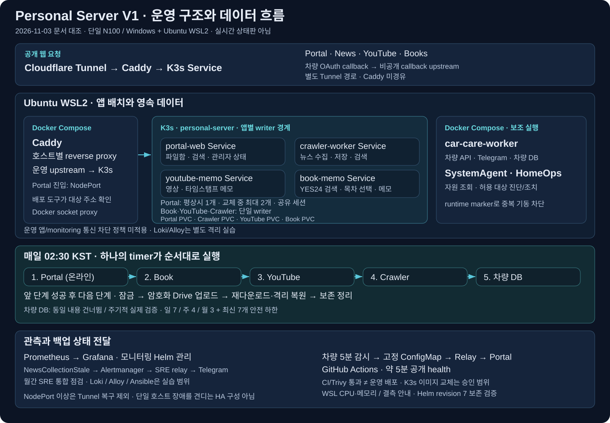

# Personal Server V1 면접 설명 자료

[쉽게 읽는 개념·예상 질문 24개](20261103_V1_쉬운개념과_면접문답.md) · [V1·V2 기준자료](20261103_V1V2_학습기준자료.md)

## 1. 문서 정보

| 항목 | 내용 | 비고 |
|---|---|---|
| 갱신일 | 2026-11-03 | Asia/Seoul |
| 목적 | 면접관에게 문제·설계 선택·검증 결과·한계를 설명함 | 기술 목록보다 판단 근거를 우선함 |
| 기준 자료 | [README](../README.md), [개발·운영 기록](20260921_프로젝트보완_개발계획.md), 아래 코드·검증 원본 | 이번 갱신은 문서 작업이며 운영 상태 재측정 아님 |
| 수행 구분 | 사용자 요구·운영 판단, 에이전트 지원 구현·자동 실행, 독립 검토·CI를 구분함 | 본인 직접 진단·설명은 별도 실습으로 확인 필요 |

## 2. 핵심 요약 — 1분 소개

> 개인 데이터를 관리하는 Portal·책·영상·뉴스·차량 서비스를 N100 한 대에서 운영하는 프로젝트입니다. 웹 앱은 K3s, 호스트와 가까운 보조 작업은 Compose로 나눴습니다. 개인 데이터 규모에 맞춰 SQLite와 파일을 사용하면서, 응답 유실에 따른 중복 저장·동시 편집 충돌·배포 중 중복 writer를 제어했습니다. 운영에서는 내부 지표와 외부 health를 구분하고, 백업은 암호화 업로드 뒤 같은 사본을 다시 내려받아 격리 복원까지 확인합니다. 최근에는 Grafana 지표·결측 표시와 Helm 업그레이드 보존을 검증했습니다. 단일 호스트이므로 HA나 대규모 트래픽 운영으로 설명하지 않으며, 별도 V2에서 GitOps와 장애 진단을 실습합니다.

이 소개는 프로젝트의 동작을 설명하는 예시임. 개인의 실제 작성·운영·판단 범위를 확인하고 말하며, 자동 실행 결과를 본인의 수동 사고 대응으로 설명하지 않음.

## 3. 상세 내용

### 3.1. 구성도를 보며 설명할 요청·데이터·운영 흐름

| 흐름 | 설명할 내용 | 비고 |
|---|---|---|
| 공개 요청 | Cloudflare Tunnel → Compose Caddy → K3s Service → 앱 | Portal은 NodePort 진입, 차량 OAuth callback은 별도 Tunnel 경로 |
| 앱 책임 | Portal이 Book·YouTube·Crawler API 결과를 모으고 각 서비스가 자기 데이터를 관리함 | 실패와 검색 결과 0건을 분리함 |
| 데이터 | 서비스별 SQLite·JSON·파일을 PVC 등에 보관함 | PVC 존재는 백업·물리 HA의 증거가 아님 |
| 쓰기 경계 | Book·YouTube·Crawler 단일 writer, runtime marker와 실제 상태로 중복 실행을 차단함 | Portal은 별도 검증한 공유 상태·온라인 snapshot 범위에서 평상시 1개, 교체 중 최대 2개 |
| 관측 | 지표 → Prometheus → Grafana, 경보 → Alertmanager → SRE relay → Telegram | 수집 중단·서비스 실패·외부 접근·알림 수신을 구분함 |
| 백업 | 하나의 timer가 Portal 온라인 snapshot → Book → YouTube → Crawler → 차량 DB 순서로 실행함 | 암호화 원격 저장·재다운로드·격리 복원·안전 보관 정리 |

### 3.2. 기술 선택과 대안의 판단

| 선택 | 선택 이유 | 바꿔야 할 조건·한계 | 비고 |
|---|---|---|---|
| SQLite·파일 | 개인 데이터 규모에서 별도 DB 서버 부담을 줄이고 데이터 책임을 분리함 | 다중 호스트 쓰기·큰 쓰기 부하에는 저장·동시성 설계 재검토 필요 | Portal의 제한된 롤링 쓰기를 일반화하지 않음 |
| K3s + Compose | 웹 앱의 Deployment·readiness·PVC 관리와 호스트 보조 작업을 분리함 | 관리 경로가 둘이므로 실행 소유권 검사 필요 | 같은 운영 writer의 중복 기동 금지 |
| 스크립트 기반 제한 배포 | 검증한 이미지·현재 상태·허용 서비스만 교체하고 실패 시 원복함 | Git 선언과 실제 상태의 지속 비교는 V2 GitOps에서 실습함 | V1 전체 Argo 관리 전환 아님 |
| 백업 후 복원 검증 | 업로드 성공만으로 복구 가능성을 판단할 수 없음 | 실제 재해에는 이미지·설정·키·실행 환경 재공급도 필요 | 같은 호스트 격리 검증과 전체 DR 분리 |
| 제한 자동복구 | 대상·조건·쿨다운·횟수 제한으로 복구의 부작용을 줄임 | 호스트 전체가 중단되면 내부 감시도 영향을 받음 | 무조건 재시작하는 자동화 아님 |

### 3.3. 문제 → 해결 → 검증 사례

| 문제 | 해결과 판단 | 코드·검증 근거 | 비고 |
|---|---|---|---|
| 한 검색 대상 지연이 전체 결과를 가림 | 병렬 조회·1.5초 조회 예산·서비스별 상태/결과 분리 | [통합 검색](../portal-web/app/services/global_search.py), [회귀](../tests/test_portal_dashboard.py) | 전체 브라우저 응답 시간 보장 아님 |
| 같은 이름 동시 업로드 | 배타적 생성과 생성한 요청만 정리하도록 제어 | [파일 저장](../portal-web/app/services/file_store.py), [회귀](../tests/test_file_access.py) | 존재 검사 후 쓰기의 경쟁 조건 방지 |
| 응답 유실 후 중복 저장·오래된 편집 | 요청 ID·본문 해시·결과를 업무 데이터와 같은 트랜잭션에 저장하고 버전 충돌은 409로 거부 | [Book 회귀](../tests/book_memo/test_memo_recovery.py), [YouTube 회귀](../tests/youtube_memo/test_memo_recovery.py) | 모든 쓰기 경로의 exactly-once 보장으로 확대하지 않음 |
| 배포·복구가 K3s 앱을 Compose에서 재기동 | runtime marker·실제 실행 상태 대조, 불명확하면 중단 | [실행 위치 검사](../scripts/runtime-service-state-reader.py) | 데이터가 같은 두 writer 실행 방지 |
| 화면은 열리지만 뉴스 수집은 중단 | 마지막 정상 수집·시도·연속 실패·최신성을 분리 | [수집 상태](../crawler-worker/app/services/news_collection_status.py), [SLI 기준](slo-baseline.md) | HTTP 200만으로 정상 수집 확정 불가 |
| Grafana 결측과 업그레이드 후 변경 유실 우려 | 실제 지표·필터·질의를 대조하고 지원/미지원 안내, Helm 저장 manifest와 live 보존 확인 | [결측 검증](20261102_Grafana_결측안내_운영검증.md), [Helm 검증](20261102_Grafana_Helm운영검증.md) | WSL 지표와 Windows 호스트 지표 구분 |
| 백업 파일은 있지만 복구 가능성 불명 | 같은 원격 사본 재다운로드·무결성·격리 복원·증거 유효성 확인 | [순차 실행기](../infra/k8s/tools/pvc-backup-sequence.py), [운영 기준](operations-reference.md#차량-db-백업과-자동-보관) | 업로드·복원·운영 데이터 복구는 별도 상태 |

### 3.4. 최근 검증 결과와 근거의 범위

| 항목 | 확인한 결과 | 한계·비고 |
|---|---|---|
| 정기 백업·보관 | 2026-10-19 다섯 단계의 당일 백업·복원, 네 앱의 원격 사본 각 1개 자동 삭제 확인 | 차량 보관 정리는 당시 no_op, 차량 기간 경과 삭제·30일 기록 정리는 별도 관찰. [운영 기록](operations-reference.md#차량-db-백업과-자동-보관) |
| 알림 전달 | 디스크 및 검색 관측 합성 시험의 발생·복구 전송과 사용자 단말 수신 확인 | 자연 장애의 임계값 발화와 장기 인증 상태를 보장하지 않음. [검색 경보 시험](reviews/20261028_검색관측경보_메시지검증.md) |
| Portal 서비스 연속성 | 승인된 롤링 교체·온라인 백업에서 같은 로그인으로 조회·저장·수정 및 데이터 보존 검증 | 해당 교체의 제한된 검증이며 일반 다중 호스트 확장 아님. [개발 기록](20260921_프로젝트보완_개발계획.md) |
| Grafana·Helm | 2026-11-02 chart 88.6.1 revision 6→7, 대시보드 수정·UID·앱/PVC/Secret 보존 확인 | Helm release는 모니터링 차트 하나. 앱 YAML·Git 소유 별도 수집기/대시보드까지 Helm 전환한 것은 아님 |
| 뉴스 원시 관측 | 2026-11-03 관측 도구 한정 적용·반입·health 검증 완료 | 새 형식 자연 capsule은 11월 4일 이후 확인 필요. 동일 기준 30일 SLO 통과 아님. [최신 기록](20260921_프로젝트보완_개발계획.md#뉴스-수집-원시-관측-보존-확장--운영-미적용) |
| 합성 Book VM 복구 | 2026-11-02 원본 VM·디스크 제거 뒤 새 Linux VM에서 복원·읽기·수정·재전송 검증 | 같은 Mac·사전 준비 자산·합성 데이터. 운영 N100·물리 호스트 소실·운영 RTO/RPO 아님. [VM 기록](20260921_프로젝트보완_개발계획.md#독립-linux-vm-소실합성-book-복구-훈련) |

각 결과는 해당 실행일의 증거임. 오늘 문서 갱신을 모든 서비스·백업·대시보드의 실시간 정상 판정으로 사용하지 않음.

### 3.5. 추가 로컬 실습 사례: 운영 이력과 구분

다음은 에이전트 도움으로 구현한 도구의 자동 실행 결과임. 사용자의 수동 진단·운영 복구 실적으로 표현하지 않음. 기존 운영 이력의 최신성을 이번 문서 작업으로 재검증한 것은 아님.

| 단계·주제 | 확인한 결과 | 코드·원본 | 범위·비고 |
|---|---|---|---|
| 1. 통합 검색 성능 | 36셀·1,080개 표본, timeout·503에서 다른 두 소스 결과 유지 | [도구](../portal-web/tools/search_performance_lab.py), [원본](reviews/20261017_통합검색성능실습_측정원본.json), [해석](reviews/20261017_통합검색성능실습_검증결과.md) | 실제 검색 함수와 고정 HTTP 샘플의 로컬 측정, 운영 최대 RPS·성능 개선 아님 |
| 2. 장애 진단·복구 | timeout·SQLite BUSY·FULL 각 3회, 실패 원자성·복구 후 동일 요청 단일 적용·정리 확인 | [도구](../book-memo/tools/incident_recovery_lab.py), [원본](reviews/20261017_장애진단복구실습_측정원본.json), [DB 잠금 사례](reviews/20261018_DB잠금_사례보고서.md), [신규 잠금 1회 원본](reviews/20261018_DB잠금_측정원본.json) | 신규 잠금 1회도 별도 통과함. 알려진 장애의 자동 검사, 사람의 RCA·MTTR 아님 |
| 3. 배포 표준화 | 실제 Book HTTP·readiness, 정상 교체 3회·실패 후 롤백 3회·변조 차단 3회 | [도구](../book-memo/tools/deployment_standard_lab.py), [원본](reviews/20261017_배포표준화실습_측정원본.json), [해석](reviews/20261017_배포표준화실습_검증결과.md) | 기존 결과는 같은 앱 payload의 프로세스 교체, 두 코드 버전 Docker·운영 배포 아님 |

추가 Docker 실습은 서로 다른 앱 코드 `d0a60639`→`c8759902`로 upgrade·왕복·readiness 실패 각 3회, 총 9회를 통과함. [도구](../book-memo/tools/container_release_lab.py)와 [원본](reviews/20261018_컨테이너버전교체_측정원본.json)에서 실제 소스 해시·OpenAPI 차이·로컬 image ID를 연결함. v2 쓰기 뒤 v1 읽기·쓰기를 확인했으며 두 앱 버전 컨테이너는 동시에 구동하지 않음. 동일 현행 Dockerfile·의존성을 사용한 schema 불변 경로의 로컬 검증이며 과거 전체 환경·HTTP 쓰기 인증·운영 배포·무중단 전환은 미검증임. 직접 학습은 [DB 잠금 실습지](20261018_DB잠금_실습지.md)를 작성하고 [면접 답변](20261018_DevOps_면접답변.md)의 범위·한계와 대조함.

## 4. 예상 질문과 답변

| 질문 | 설명할 핵심 | 비고 |
|---|---|---|
| 왜 GitOps로 바로 바꾸지 않았나요? | 기존 배포 보호·writer·데이터 계약을 유지하면서 V2에서 GitOps를 검증함. V1 전환에는 운영 선언 정합성과 관리권 인수 검증이 필요함 | 기존 도구와 Argo의 같은 Deployment 이중 관리 금지 |
| CI 성공인데 배포가 실패할 수 있나요? | CI는 코드·계약 검사이며 N100 이미지 공급·적용·업무 동작·외부 접근은 별도 확인함 | blocked_path는 정책상 배포 제외일 수 있음 |
| health와 readiness는 무엇이 다른가요? | 구현된 검사 조건을 설명하고, 프로세스 응답·트래픽 수용·업무 쓰기 검증을 구분함 | 이름만으로 DB 쓰기 가능까지 보장하지 않음 |
| 재시도하면 중복 저장되지 않나요? | 요청 ID만 믿지 않고 본문 해시·결과·업무 데이터를 같은 트랜잭션으로 관리함 | 같은 ID에 다른 내용인 요청과 편집 버전 충돌도 구분 |
| 이전 이미지로 돌리면 데이터도 돌아가나요? | 이미지는 코드 복귀이며 PVC·DB는 그대로임. 이전 코드와 현재 스키마/데이터의 호환성을 검사함 | 데이터 복원·writer 전환은 별도 작업 |
| 백업은 어떻게 성공 판정하나요? | 업로드→같은 암호문 다운로드→무결성→격리 복원→증거 유효성까지 확인함 | 전체 환경 복구와 보장 RTO/RPO는 별도 |
| Prometheus·Grafana는 모두 Helm으로 관리하나요? | 모니터링 chart release와 Git YAML 소유 자원을 구분함. 실제 업그레이드 후 저장 manifest·live를 대조함 | Helm 사용이 전체 시스템 Helm 전환을 뜻하지 않음 |
| HA나 SLO를 달성했나요? | 단일 N100으로 물리 HA는 제공하지 않음. SLO도 동일 기준·기간·coverage가 충족된 근거가 있어야 판정함 | 일일 기록 30행·Pod Ready·짧은 관측으로 대체하지 않음 |

## 5. 검토 결과·확인 필요 사항

| 구분 | 현재 설명 가능한 범위 | 확인 필요·한계 |
|---|---|---|
| 운영 구조 | K3s/Compose 소유·공개 경로·앱별 writer·백업/복구 경계를 설명함 | 단일 호스트·WSL2 장애 한계 |
| 관측 | WSL CPU/메모리, Windows C:·노드/PVC 관측 등 검증 범위를 구분함 | 모든 호스트 지표·전체 로그 수집 증거는 아님. 운영 통신 차단 정책 미적용 |
| 데이터 | 지정된 쓰기 경로의 중복·충돌·잠금과 Portal 제한 롤링을 구분함 | 모든 쓰기·탭 종료 초안 복구 보장 아님 |
| 성과 | 코드·자동 실습·실제 운영·독립 검토·CI·수신 확인을 분리함 | 사용자 직접 진단 및 동일 기준 30일 SLO·전체 운영 RTO/RPO는 확인 필요 |

## 6. 후속 학습과 자료

[직접 학습 계획](20261026_V1_고도화학습계획.md)의 첫 미완료 과제부터 요청 경로·실행 위치·데이터·복구 판단을 본인 말로 설명함. 작은 변경·장애 진단은 별도 V2에서 직접 실습하며, 문서 저장을 운영 배포 승인으로 확대하지 않음.

[공개 소개 원문](portfolio-content.md) · [상세 답변·실습 수치](20261018_DevOps_면접답변.md) · [이미지 촬영일·범위](images/README.md) · [운영 참조](operations-reference.md) · [V2 면접 자료](https://github.com/Len-Yoon/personal-server-v2/blob/main/docs/portfolio-devops.md)
